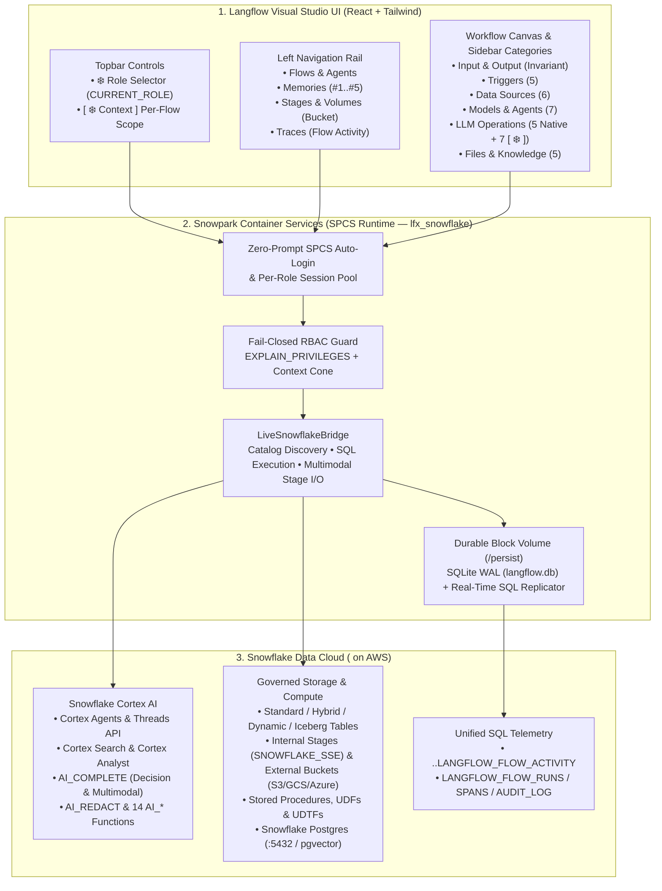
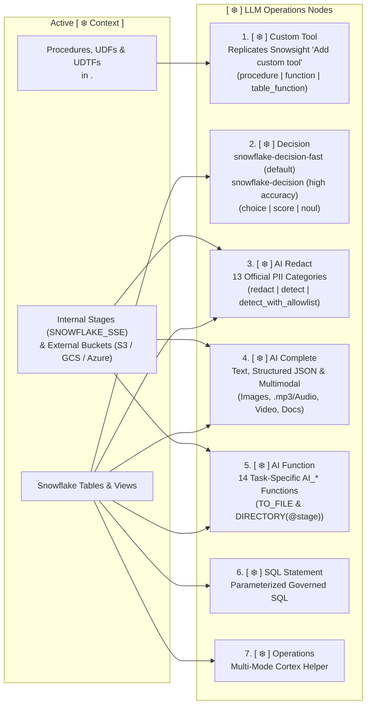
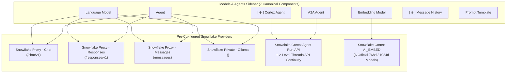
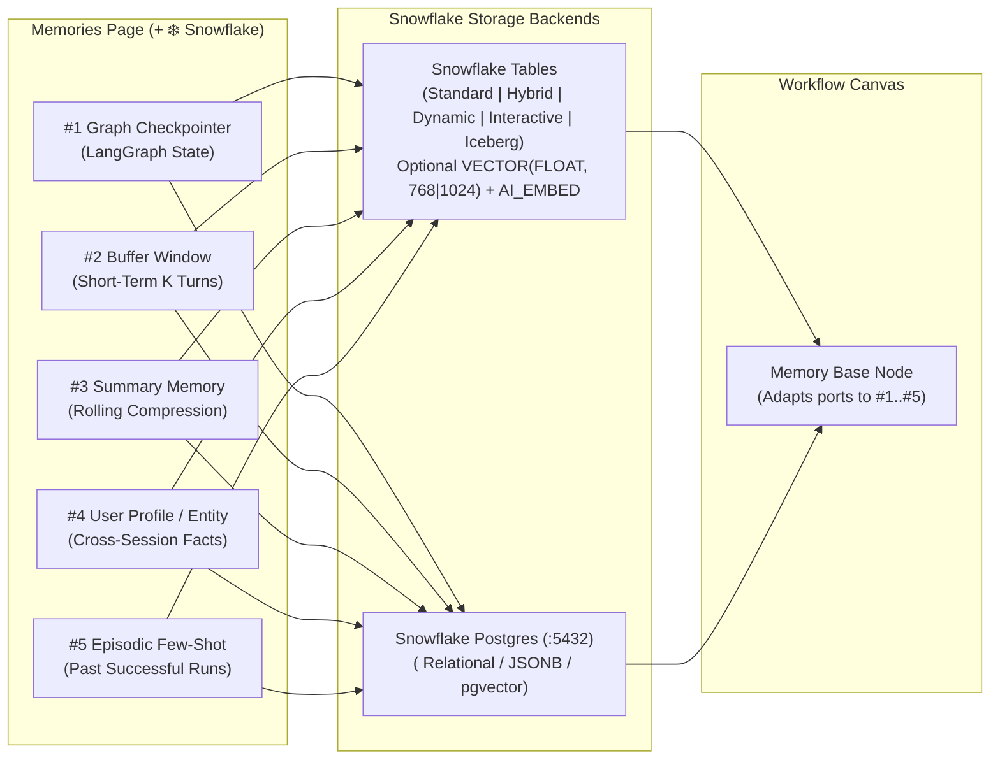

<div align="center">

# Native Snowflake Langflow

**Snowflake-native governance, Cortex AI, and SPCS integration for Langflow.**

[](LICENSE)
[](https://www.python.org/)
[](https://docs.snowflake.com/)
[](https://github.com/langflow-ai/langflow)

</div>

> [!WARNING]
> **Unofficial personal fork, under active testing.** This repository ([`fbattaglieri-snowflake/Native-Snowflake-Langflow`](https://github.com/fbattaglieri-snowflake/Native-Snowflake-Langflow)) is an independent project by **Francesco Battaglieri** ([@fbattaglieri-snowflake](https://github.com/fbattaglieri-snowflake)). It is **NOT an official product, release, or repository of Snowflake Inc.**, nor is it an official project of Langflow / DataStax, and it is not supported or warranted by either. APIs, components, SQL schemas, and configuration may change without notice. Do not deploy to production without your own qualification and security review.

> [!TIP]
> This is a public fork of [langflow-ai/langflow](https://github.com/langflow-ai/langflow) released under the **MIT License**. It contains only the Snowflake extension code (the isolated `lfx_snowflake` package, installer, SQL and docs), not the upstream source. The release image is built on the official `langflowai/langflow:1.13.1` image pinned by digest (`v1.13.1` baseline).

> [!NOTE]
> **v0.8.6 released.** Security perimeter, RBAC, fail-closed context enforcement, governed memories and unified telemetry. See the [v0.8.6 changelog](#changelog).

> [!NOTE]
> **W3-R1 redesign in progress.** Memories, Knowledge & Files, caller identity, and traceability are being reworked. Phase 0 (safety fixes) and Phase 1 (identity and traceability plumbing) are merged; the Langflow 1.13.1 base-image upgrade is deployed. Caller's-rights execution is still disabled by default, stage upload is not implemented yet, and the Phase 2 Memories/Files work has not started. See [Status & Roadmap](#status--roadmap).

---

## At a Glance: Why Native Snowflake Langflow?

**Native Snowflake Langflow** keeps 100% of the standard Langflow visual experience while turning every workflow into a **first-class, role-governed Snowflake application** running inside **Snowpark Container Services (SPCS)**.

| Pillar | What It Does | Where in the UI | Status |
|---|---|---|---|
| **1. Role-scoped Snowflake access** | Queries run through a service session scoped to the role selected in the topbar. True caller's-rights execution (per-user identity) is not live yet. | **`❄️ Role: [ <ROLE> ▾ ]`** in the topbar | In progress (caller's rights: implemented, disabled by default) |
| **2. Per-Flow `[ ❄️ Context ]`** | Each flow defines its own visibility scope (databases, schemas, tables, views, stages, routines, Cortex Agents, Snowflake Postgres). | **`[ ❄️ Context ]`** in the flow editor | Live |
| **3. Native Cortex AI & Multimodal** | Visual nodes for Cortex Agent, Search, Analyst, Custom Tool, Decision, AI Redact, AI Complete, and 14 `AI_*` functions over stages. | **`[ ❄️ ]`** components in the sidebar | Live |
| **4. Memories, Knowledge & Files** | Agent memories, knowledge bases, and stage files backed by real Snowflake objects only. Internal and external stages are listed from live Snowflake metadata; uploads go to internal stages only; External Volumes move to a separate configuration panel. | **`Memories`**, **`Stages & Volumes`** | Under redesign (W3-R1) — Planned |
| **5. Snowflake Triggers** | `TASK`, `STREAM` (table/stage), and `ALERT` triggers that run Langflow flows from Snowflake data changes. | **`Triggers`** sidebar category | Live |
| **6. SQL Observability** | Flow runs, spans, and audit events are replicated to Snowflake SQL tables. Per-user attribution and query tags are being completed. | **`Flow Activity`**, `<DATABASE>.<SCHEMA>.LANGFLOW_FLOW_ACTIVITY` | Live (attribution: In progress) |

---

## Status & Roadmap

| Area | Status | Notes |
|---|---|---|
| `[ ❄️ Context ]`, Cortex AI nodes, 5 Triggers | Live | Behaviour unchanged by W3-R1 |
| Langflow 1.13.1 base image | Live | Pinned official image + fail-closed installer; core DB on the `/persist` block volume |
| Memories pages and Memory Base | Live (v0.8.6) | Governed `LF_MEM_*` objects, single `AI_EMBED` catalog, kill phrase |
| Stages & Volumes | In progress | Internal and external stages from live metadata; upload to internal stages only; External Volumes in a separate panel |
| Message History on Snowflake | Live (v0.8.6) | Governed table (`LANGFLOW_MESSAGES_TABLE`), role-scoped |
| Caller's-rights identity | Live (v0.8.6, opt-in) | Per-user/flow role sessions; caller's-rights role precedence; disabled by default |
| Stage upload | Planned | Returns `501 Not Implemented` today |
| Traceability (query tags, audit) | Live (v0.8.6) | Unified run/trace telemetry: one RUN per execution, batched span sync on run close |

---

## 1. End-to-End Architecture



---

## 2. How Role Governance & Per-Flow `[ ❄️ Context ]` Work

Every workflow has its own **isolated context cone**. Selecting databases, schemas, or objects in **Flow A** never pollutes **Flow B**, and switching the active role in the topbar dynamically computes the intersection between the flow's context and the role's live privileges.

```mermaid
sequenceDiagram
    autonumber
    actor User as User in Browser
    participant UI as Topbar & Canvas Nodes
    participant Bridge as LiveSnowflakeBridge (SPCS)
    participant SF as Snowflake (<SNOWFLAKE_ACCOUNT>)

    User->>UI: 1. Select Active Role (❄️ Role)
    UI->>Bridge: POST /api/v1/snowflake/context (role)
    Bridge->>SF: USE ROLE <ROLE>; SELECT CURRENT_ROLE();
    SF-->>Bridge: Active role verified (context_epoch++)

    User->>UI: 2. Open [ ❄️ Context ] inside /flow/<flow_id>
    UI->>Bridge: Browse Databases ▸ Schemas ▸ Objects + Postgres
    User->>UI: Check allowed Databases / Schemas / Stages / Routines
    UI->>Bridge: Save isolated context for <flow_id>
    Bridge-->>UI: Instantly updates all Canvas Node dropdowns (< 5 ms)

    User->>UI: 3. Run Workflow Node (SQL / AI_* / Custom Tool)
    UI->>Bridge: Execute node with X-Snowflake-Flow-Id
    Bridge->>SF: Verify EXPLAIN_PRIVILEGES & execute under CURRENT_ROLE()
    SF-->>Bridge: Result + Query ID
    Bridge->>SF: Async MERGE INTO <DATABASE>.<SCHEMA>.LANGFLOW_FLOW_ACTIVITY
    Bridge-->>UI: Return result to Canvas / Playground
```

---

## 3. Visual Guide to the Sidebar Categories

All Snowflake components are cleanly integrated into the native Langflow sidebar categories (`1 Component class = 1 Python file`), with zero redundant bottom bundles.

```text
+---------------------------------------------------------------------------------------------------+
|  LANGFLOW SIDEBAR CATEGORIES                                                                      |
|                                                                                                   |
|  1. Input & Output     -> Chat Input, Chat Output, Text Input, Text Output, Webhook (Invariant)   |
|  2. Triggers           -> [❄️] Schedule | [❄️] Table Change | [❄️] Stage File | [❄️] Alert | Webhook |
|  3. Data Sources       -> [❄️] Tables | [❄️] Views | [❄️] Iceberg | [❄️] Postgres | Search | Analyst |
|  4. Models & Agents    -> Language Model | Agent | [❄️] Cortex Agent | A2A | Embedding | History   |
|  5. LLM Operations     -> [❄️] Custom Tool | [❄️] Decision | [❄️] AI Redact | [❄️] AI Complete | ... |
|  6. Files & Knowledge  -> File System | Knowledge | Memory Base | Read File | Write File          |
+---------------------------------------------------------------------------------------------------+
```

---

### 3.1 `LLM Operations` — Cortex AI, Custom Tools & Structured Decisions

The **`LLM Operations`** category combines the 5 native Langflow operations (`Batch Run`, `Guardrails`, `Smart Router`, `Smart Transform`, `Structured Output`) with **7 Snowflake Cortex components**:



| Component (`display_name`) | Class (`name`) | What It Does & Key Capabilities |
|---|---|---|
| **`[ ❄️ ] Custom Tool`** | `SnowflakeCustomTool` | Replicates the Snowsight Cortex Agent **"Add custom tool"** dialog 1:1. Supports `procedure`, scalar `function` (`UDF`), and `table_function` (`UDTF`). Auto-populates parameters from `DESCRIBE PROCEDURE/FUNCTION`, supports manual parameter editing (`+ Add parameter` / `Delete`, `Sort by: Latest added \| Alphabetical \| Required first`), blocks unsupported `OBJECT` parameters, supports `User's default` or `Custom` warehouse + `Query timeout (1–600s)`, and outputs both a Cortex Agent `Tool` (`tool_spec` + `tool_resources`) and direct SQL execution (`CALL` / `SELECT` / `TABLE(...)`). |
| **`[ ❄️ ] Decision`** | `SnowflakeDecision` | Implements official **Snowflake Decision with `AI_COMPLETE`** across the two dedicated models: **`snowflake-decision-fast`** *(Default — low latency, 2–16 `choice` options, 32k token limit)* and **`snowflake-decision`** *(High accuracy, 2–32 `choice` options, 256 KiB JSON limit)*. Supports **1–32 questions per call** (max 256 total options) across **`choice`**, **`score`** (`0..n-1` rubric with weighted average $\sum_{i=0}^{n-1} i \cdot p_i$), and **`noul`** (statement probability in `~0.08–0.92`), normalized confidence $\frac{n \cdot p_{\max} - 1}{n - 1}$, Single-State and Table-Level processing, and **High vs. Low Confidence Routing** outputs. |
| **`[ ❄️ ] AI Redact`** | `SnowflakeAIRedact` | Dedicated PII detection and masking component (`AI_REDACT`) supporting **`redact`**, **`detect`** (with automatic span masking in traces), and **`detect_with_allowlist`** (selective redaction splicing in reverse index order). Covers all **13 official Snowflake PII categories** (`NAME`, `EMAIL`, `PHONE_NUMBER`, `DATE_OF_BIRTH`, `GENDER`, `AGE`, `ADDRESS`, `NATIONAL_ID`, `PASSPORT`, `TAX_IDENTIFIER`, `PAYMENT_CARD_DATA`, `DRIVERS_LICENSE`, `IP_ADDRESS`), enforces the 4,096-token limit via `AI_COUNT_TOKENS('ai_redact', ...)` with automatic `SPLIT_TEXT_RECURSIVE_CHARACTER` chunking, and supports pre-conversion from stage documents/audio. |
| **`[ ❄️ ] AI Complete`** | `SnowflakeAIComplete` | Generative `AI_COMPLETE` node supporting text prompts, `model_parameters`, forced JSON schema output (`response_format`), and **direct multimodal inputs (`TO_FILE` & `DIRECTORY(@stage)`)** from Internal Stages and External Buckets (`S3`, `GCS`, `Azure`) for **images**, **`.mp3`/audio**, and **video** (including `gemini-3.1-pro`, `gemini-3.1-flash-lite`, `gemini-3.5-flash`). |
| **`[ ❄️ ] AI Function`** | `SnowflakeAIFunction` | Unified node for the **14 task-specific Cortex AI Functions**: `AI_CLASSIFY`, `AI_FILTER`, `AI_EXTRACT`, `AI_SENTIMENT`, `AI_SUMMARIZE`, `AI_SUMMARIZE_AGG`, `AI_AGG`, `AI_TRANSLATE`, `AI_SIMILARITY`, `AI_TRANSCRIBE` (with `word`/`speaker` timestamps on `.mp3`/audio/video), `AI_PARSE_DOCUMENT` (`LAYOUT`/`OCR`), `AI_EMBED`, `AI_MULTI_EMBED` (`twelvelabs-marengo-embed-3-0` on image/audio/video), and `AI_COUNT_TOKENS`, reading from both tables and **Internal / External Stages**. |
| **`[ ❄️ ] SQL Statement`** | `SnowflakeSQLStatement` | Executes governed parameterized SQL (`SELECT`, `CALL`) within `<DATABASE>.<SCHEMA>` under `CURRENT_ROLE()`, returning either a `DataFrame` or structured `JSON` (`OBJECT_CONSTRUCT(*)`). |
| **`[ ❄️ ] Operations`** | `SnowflakeLLMNode` | Multi-operation Snowflake Cortex and SQL utility node synchronized with the active flow context. |

---

### 3.2 Multimodal Stage & Cloud Bucket Support (`Internal` & `External`)

Both **`[ ❄️ ] AI Function`** and **`[ ❄️ ] AI Complete`** read media files directly from **Internal Stages** (`SNOWFLAKE_SSE` / `SNOWFLAKE_FULL`) and **External Cloud Stages** (`Amazon S3`, `Google Cloud Storage`, `Microsoft Azure`, `S3-Compatible`) enabled in `[ ❄️ Context ]`:

| Media Category | Supported Extensions | Enabled Cortex Functions | Execution Modes |
|---|---|---|---|
| **Images** | `.jpg`, `.jpeg`, `.png`, `.webp`, `.gif`, `.bmp` | `AI_COMPLETE`, `AI_CLASSIFY`, `AI_FILTER`, `AI_EXTRACT`, `AI_SUMMARIZE`, `AI_SIMILARITY`, `AI_PARSE_DOCUMENT`, `AI_EMBED`, `AI_MULTI_EMBED` | Single/Multi-file `TO_FILE('@<DATABASE>.<SCHEMA>.<STAGE_NAME>', '<path>')` or Batch `DIRECTORY(@<DATABASE>.<SCHEMA>.<STAGE_NAME>)` |
| **Audio / `.mp3`** | `.mp3`, `.wav`, `.flac`, `.m4a`, `.ogg`, `.aac`, `.webm`, `.mp4` | `AI_TRANSCRIBE` (`word` / `speaker` timestamps), `AI_COMPLETE` (`gemini-3.1-pro`, `gemini-3.1-flash-lite`, `gemini-3.5-flash`), `AI_MULTI_EMBED` (`twelvelabs-marengo-embed-3-0`) | Single file `TO_FILE(...)` or Batch `DIRECTORY(@...)` |
| **Video** | `.mp4`, `.mov`, `.webm`, `.mkv`, `.avi`, `.flv`, `.mpeg`, `.mpg`, `.wmv`, `.3gpp`, `.ogv` | `AI_COMPLETE` (scene & audio analysis), `AI_TRANSCRIBE` (audio track extraction), `AI_MULTI_EMBED` (`visual`, `audio`, `transcription` embeddings) | Single file `TO_FILE(...)` or Batch `DIRECTORY(@...)` |
| **Documents** | `.pdf`, `.docx`, `.pptx`, `.html`, `.txt`, `.md`, `.eml`, `.tiff` | `AI_PARSE_DOCUMENT` (`LAYOUT` / `OCR`, `page_split`), `AI_EXTRACT`, `AI_SUMMARIZE` | Single file `TO_FILE(...)` or Batch `DIRECTORY(@...)` |

---

### 3.3 `Models & Agents` — 4 Snowflake Model Providers, Cortex Agents & A2A



- **Dynamic Reasoning Controls:** Selecting a reasoning-capable model under `Snowflake Proxy - Chat`, `Responses`, or `Messages` automatically reveals `Reasoning Effort` or `Extended Thinking` (`Thinking Budget Tokens`) directly below the model selector while hiding API key fields (handled by SPCS).
- **Proxy Models Without a Release:** The model lists come from the proxy `GET /<protocol>/v1/models` endpoints (15 s server cache, 30 s browser refresh). A model the proxy promotes appears in `Language Model`, `Agent` and the `Create Memory` preprocessing engines within about a minute, already enabled; a revoked model disappears the same way. If the proxy is briefly unreachable, the last list it returned is kept (one warning per outage in the logs); the built-in static list is only used on a cold start.
- **Snowflake Cortex Embeddings:** The 6 `AI_EMBED` models are registered as the `Snowflake Cortex` provider in Langflow's provider registry, so `Embedding Model` lists them and saved selections never show as "Not available".
- **2-Level Cortex Agent Threads:** `[ ❄️ ] Cortex Agent` preserves multi-turn conversation state across turns using a local SQLite thread cache (`0 ms` overhead) backed by the Snowflake Cortex `Threads API` (`/api/v2/cortex/threads`).

---

### 3.4 `Files & Knowledge`, `Memories (#1..#5)` & `Stages & Volumes`

The left navigation rail includes dedicated views for **`Memories`** (with the **`[ + ❄️ Snowflake ]`** wizard, which automatically dismisses transient popovers on tab switch, outside click, or `Escape`) and **`Stages & Volumes`** (Bucket icon above `Traces`).



---

### 3.5 `Triggers` — Event-Driven & Scheduled Snowflake Execution

Positioned immediately after `Input & Output`, the **`Triggers`** category provides **5 specialized components** powered by the SPCS Service Function `<DATABASE>.<SCHEMA>.RUN_LANGFLOW_FLOW(flow_id, trigger_payload)`:

| Trigger Component | Snowflake Primitive | When It Fires |
|---|---|---|
| **`[ ❄️ ] Schedule Trigger`** | `CREATE OR ALTER TASK ... SCHEDULE = 'USING CRON ...'` | Time-based cron or interval schedules (`Minutes`, `Hours`, `Days`, `Weeks`, `Months`). |
| **`[ ❄️ ] Table Change Trigger`** | `CREATE STREAM ON TABLE/VIEW` + Triggered Task `WHEN SYSTEM$STREAM_HAS_DATA(...)` | Row inserts/updates/deletes (CDC) on any table or view in `[ ❄️ Context ]`. |
| **`[ ❄️ ] Stage File Trigger`** | `DIRECTORY = (ENABLE = TRUE)` + `CREATE STREAM ON STAGE` + Triggered Task | New or updated files arriving on `@<DATABASE>.<SCHEMA>.<STAGE_NAME>`. |
| **`[ ❄️ ] Condition Alert Trigger`** | `CREATE OR ALTER ALERT ... IF (EXISTS (<sql>))` | SQL threshold or anomaly conditions evaluated periodically or on new data. |
| **`Webhook`** | Native HTTP Webhook Endpoint | External HTTP POST payloads (`WEBHOOK_RUN`). |

---

### 3.6 `Data Sources` — Governed Business Data & Semantic Models

| Component | Hierarchy in Node | Description |
|---|---|---|
| **`[ ❄️ ] Tables`** | `Database -> Schema -> Table Type -> Table` | Reads `Standard`, `Hybrid`, `Dynamic`, and `Interactive` tables in `[ ❄️ Context ]`. |
| **`[ ❄️ ] Views`** | `Database -> Schema -> View Type -> View` | Reads `Standard`, `Secure`, and `Materialized` views in `[ ❄️ Context ]`. |
| **`[ ❄️ ] Iceberg Tables`** | `Database -> Schema -> Iceberg Table` | Reads Apache Iceberg tables managed in Snowflake. |
| **`[ ❄️ ] Postgres`** | `Postgres Instance -> Table / Query` | Account-level connection to `<POSTGRES_INSTANCE>` (`:5432`). |
| **`[ ❄️ ] Cortex Search`** | `Database -> Schema -> Search Service` | Queries Cortex Search services (also usable as an Agent `StructuredTool`). |
| **`[ ❄️ ] Cortex Analyst`** | `Database -> Schema -> Semantic View / @Stage YAML` | Natural-language-to-SQL via Cortex Analyst Semantic Views or stage YAML models. |

---

### 3.7 Showcase Flows

Four reference flows show the components working together. Build them with the Flows API in any project; object names are placeholders.

| Flow | What it shows |
|---|---|
| `SHOWCASE_01_Multi_Cortex_Agents_All_DataSources` | Several `Cortex Agent` nodes in sequence (with and without a thread) fed by `Tables` (standard and dynamic), `Views`, `Iceberg Tables` and a stage listing from `SQL Statement`. |
| `SHOWCASE_02_Langflow_Agent_All_Snowflake_Tools` | A Langflow `Agent` on a Snowflake Proxy model with every Snowflake component in Tool Mode (`Cortex Analyst`, `Cortex Search`, `Custom Tool`, `AI Function`, `Tables`, `Memory Base`), also exposed by the Project MCP Server. |
| `SHOWCASE_03_Language_Model_Tools_Analyst_Search_AIFunctions_Decision` | `Language Model`, `Cortex Analyst`, `Cortex Search`, AI functions and a `Decision` node: only the chosen route runs. |
| `SHOWCASE_04_A2A_All_Forms_Internal_External_And_CortexBridge` | A flow served as an A2A agent that calls three `A2A Agent` nodes (internal flow, internal Cortex Agent, external URL to the Cortex Agent bridge), with authentication, call-chain depth limit and SSRF guard. |

## 4. Tested Cloud Environment & Parametric Placeholders

**Tested Cloud Environment: AWS — Snowflake on AWS**

This solution has been architected, developed, and verified on **Snowflake on AWS** (Amazon Web Services) using Snowpark Container Services (SPCS), Snowflake Postgres, Snowflake Cortex AI Functions (`AI_*`), Cortex Analyst, Cortex Search, and Cortex Agent Run APIs. Where cross-region Cortex model inference is required on AWS deployments, configure:

```sql
ALTER ACCOUNT SET CORTEX_ENABLED_CROSS_REGION = 'ANY_REGION';
```

All configuration files, SQL scripts, and container specifications in this repository are **100% account-agnostic** and parameterized via the following placeholders:

| Placeholder | Description |
|---|---|
| `<SNOWFLAKE_ACCOUNT>` | Target Snowflake account identifier |
| `<DATABASE>` | Target Snowflake database for Langflow objects and telemetry |
| `<SCHEMA>` | Target Snowflake schema for tables, stages, and services |
| `<COMPUTE_POOL>` | SPCS Compute Pool hosting the Langflow container service |
| `<IMAGE_REPOSITORY>` | SPCS Image Repository FQN (`<DATABASE>.<SCHEMA>.<IMAGE_REPOSITORY>`) |
| `<STAGE_NAME>` | Internal or External Named Stage (`<DATABASE>.<SCHEMA>.<STAGE_NAME>`) |
| `<POSTGRES_INSTANCE>` | Snowflake Postgres instance name for ORM persistence / `pgvector` |
| `<LLM_PROXY_BASE_URL>` | Base URL of the Standard LLM Proxy service (`Chat`, `Responses`, `Messages`) |
| `<OLLAMA_BASE_URL>` | Base URL of the Snowflake-hosted Ollama service |

---

## 5. Architecture Decision Records & Documentation Index

| Document | Purpose |
|---|---|
| [`docs/CAPABILITY_MATRIX.md`](docs/CAPABILITY_MATRIX.md) | Visual capability overview, component inventory, and qualification matrix (`Q1..Q4`, `REQ-01..REQ-17`, Wave 2 enhancements) |
| [`docs/DEPLOYMENT_SPCS.md`](docs/DEPLOYMENT_SPCS.md) | Step-by-step Snowpark Container Services (SPCS) deployment guide and SQL setup |
| [`docs/UPSTREAM_SYNC.md`](docs/UPSTREAM_SYNC.md) | Governance rules (`RULE-SYNC-01..07`) for upgrading the pinned `langflow-ai/langflow` base image |
| [`docs/ADR/ADR-001.md`](docs/ADR/ADR-001.md) .. [`ADR-007.md`](docs/ADR/ADR-007.md) | Architecture Decision Records covering UI invariants, active-role RBAC, fail-closed authorization, object provisioning, multi-protocol LLM proxy, and SQL trace replication |

---

## 6. Upstream Update & Synchronization Rules (`langflow-ai/langflow`)

This fork does not carry the upstream source, so upstream updates are **not git merges**. An upgrade is a pinned base-image bump: change the `LANGFLOW_BASE` tag and digest in `Dockerfile.release`, prove that the fail-closed installer (`scripts/install_live_hooks_in_container.py --report`) still applies cleanly, rehearse the database migration on a copy, then roll out. The full procedure is in [`docs/UPSTREAM_SYNC.md`](docs/UPSTREAM_SYNC.md).

1. **`RULE-SYNC-01` — Read-Only Upstream:** `langflow-ai/langflow` and the `langflowai/langflow` images are consumed read-only; all fork commits and tags are pushed exclusively to `origin` (`snowflake/main` or scoped `feat/*` branches).
2. **`RULE-SYNC-02` — Stable Release Pinning Only:** Use only published upstream releases (no release candidates, no untagged `main`), pinned as `langflowai/langflow:<version>@sha256:<DIGEST>`.
3. **`RULE-SYNC-03` — Dedicated Upgrade Branch:** Stage every base bump on a `feat/langflow-<version>` branch and merge into `snowflake/main` only after the installer report, tests, and local rehearsal pass.
4. **`RULE-SYNC-04` — Strict `lfx_snowflake` Bundle Isolation & Tracked Hook Points:** Keep Snowflake logic inside `src/lfx_snowflake/`, `frontend_patches/`, `sql/`, and `docs/`. The installer must locate every hook point exactly as expected and fail closed otherwise; invariant categories (`Input & Output`, `Prompt Template`, `Processing`, `Flow Control`, `LLM Selector`, `Calculator`, `Current Date`) remain intact.
5. **`RULE-SYNC-05` — Mandatory Pre-Commit & CI Sanitization Gate:** `python3 scripts/verify_public_repo_sanitization.py` must pass with **0 secrets** and **0 denylist matches** across all working-tree files and Git commit history before pushing.
6. **`RULE-SYNC-06` — Full Regression & Multi-Protocol Qualification Gate:** The full `pytest` suite (`tests/`) covering RBAC role switching, 3 Proxy Standard protocols (`Chat`, `Responses`, `Messages`), Ollama, AI Functions, and SQL trace replication must pass 100%.
7. **`RULE-SYNC-07` — Pre-Upgrade Snapshot & Rollback:** Upstream migrations on the `/persist` database cannot be undone. Snapshot the `/persist` block volume (and back up `<POSTGRES_INSTANCE>` if used) before `ALTER SERVICE`; rolling back means restoring that snapshot together with the previous image.

---

## 7. Verification & Sanitization Gate

Run the automated sanitization gate and test suite before any commit or push:

```bash
python3 scripts/verify_public_repo_sanitization.py
pytest
```

---

## Changelog

### v0.8.6

**Security & RBAC**
- `/api/v1/snowflake/*` is protected by Langflow-native authentication (API key or browser session). Only the A2A agent card can be public (`SNOWFLAKE_LANGFLOW_PUBLIC_AGENT_CARD`, default on).
- Every SQL session runs `USE SECONDARY ROLES NONE` (`LANGFLOW_SECONDARY_ROLES_MODE`). If the statement fails, the request fails closed; there is no silent fallback.
- Privileged roles (e.g. `ACCOUNTADMIN`) are selectable only with a verified grant.
- Role sessions are kept per user and per flow. In caller's-rights mode the caller's selected role takes precedence over the service role.

**SQL safety & context**
- Shared `sql_safety` helper: identifier validation, typed SQL API bindings, and typed `NULL` inlining (null bindings no longer break multi-statement writes).
- Fail-closed flow `[ ❄️ Context ]` guard for all component SQL.
- Stale stored component code guard (`SNOWFLAKE_LANGFLOW_STALE_COMPONENT_POLICY=upgrade|refuse`); refresh stored flows with `scripts/refresh_stored_flow_component_code.py`.
- Canvas edge repair for API-built flows (multi-output `selected_output`, wired field visibility/types, native Tool Mode for data sources): no more edges removed on load.
- Split Text (LangChain mode) uses a bridge-owned UDF provisioned by `scripts/provision_bridge_routines.py` (see [`docs/DEPLOYMENT_SPCS.md`](docs/DEPLOYMENT_SPCS.md)).

**Components**
- Triggers: valid Snowflake Scripting, `TARGET_COMPLETION_INTERVAL`, real flow execution with the persisted role, cron steps.
- LLM Operations: Custom Tool typed arguments, Decision routing, AI Redact detect mode, `AI_COUNT_TOKENS`, SQL Statement row limits and bindings.
- Cortex Agent: thread continuity and clean `Message` output.
- A2A: call-chain limits and JSON-RPC errors `-32000` (authorization), `-32001` (task not found), `-32002` (task not cancelable).
- Memories: governed `LF_MEM_*` objects, Message History on Snowflake, single `AI_EMBED` model catalog, kill phrase.
- MCP Tools: direct streamable connection to the project MCP server (`LANGFLOW_SSRF_ALLOWED_HOSTS` must include `localhost,127.0.0.1`).
- Snowflake Proxy: `Messages`, `Responses` and `Chat` history replay per session.
- Tool Mode: `AI Function` (one tool per function, e.g. `snowflake_ai_classify`), `Tables`, `Views`, `Iceberg Tables` and `Postgres` return structured tools with a typed input schema, so a Langflow `Agent` can call them on its `Tools` port.
- `AI Complete`, `AI Function` and `AI Redact` return plain text on their `Message` output; `AI Complete` raises a clear error when the model returns an empty completion (raise `Max Tokens` for reasoning models).
- Custom Tool: boolean and numeric arguments are bound with an explicit cast (`?::BOOLEAN`, `?::NUMBER`, `?::FLOAT`); in Tool Mode a failing function or procedure fails the tool call instead of returning an empty result.
- A2A Agent: the internal target list offers only flows served as A2A agents in the same project.
- Memory Base: the preset instructions (`Session summary`, `Facts & preferences`, `Task outcomes`) drive the preprocessing step, and the `LF_MEM_*` table of a Memory Base attached to a flow stays in that flow's `[ ❄️ Context ]` when the context is saved again. Preprocessed memories are stored as plain text.
- Stages: a stage selected in the flow `[ ❄️ Context ]` is listed immediately after the context is saved.
- SQL Statement: a `Bind Values` port binds values coming from other nodes to the `?` placeholders (after the static bind parameters), and the statement runs once per run even when several output ports are connected.
- Memory Base: created in the configured `LANGFLOW_MEMORY_SCHEMA` location (`DB.SCHEMA`) whatever database the flow context starts with; a duplicate name is refused (`MEMORY_BASE_NAME_TAKEN`) before any table is created; the default preprocessing model is `claude-haiku-5-5` (override with `preproc_model`); delete is evaluated under the role of the owning flow.

**Observability**
- Unified run/trace telemetry: one RUN row per execution, batched span sync when the run closes, role-switch audit.
- Spans that cannot be linked to a single live run are attributed to a derived run id, so a span batch is never rejected for a missing run id.

**Deployment**
- New environment variables, listed in [`docs/DEPLOYMENT_SPCS.md`](docs/DEPLOYMENT_SPCS.md#6-v086-environment-variables).
- Remove any pinned `sha256:` from a spec copied out of `DESCRIBE SERVICE`, otherwise the old image keeps running.
