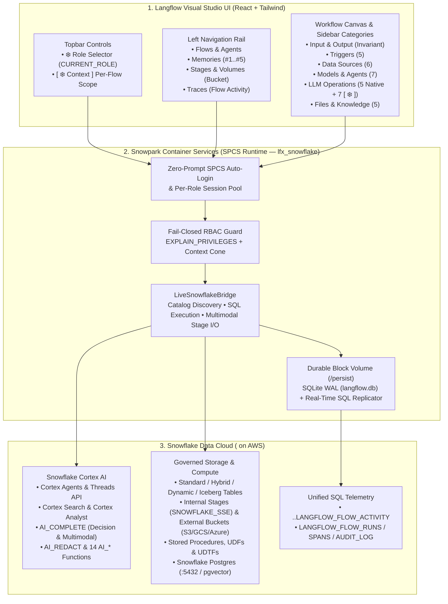
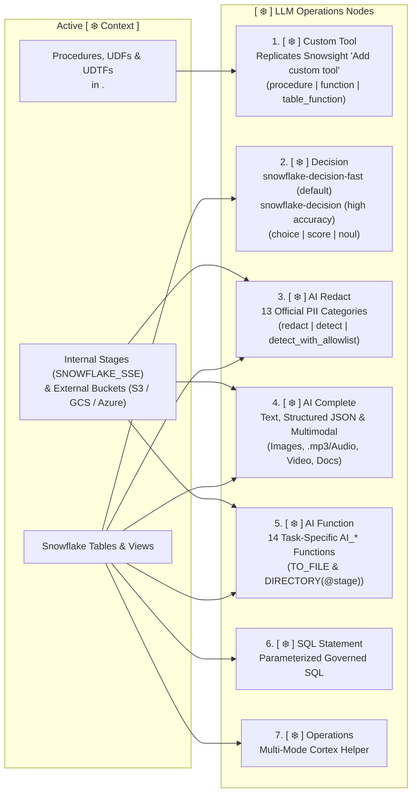
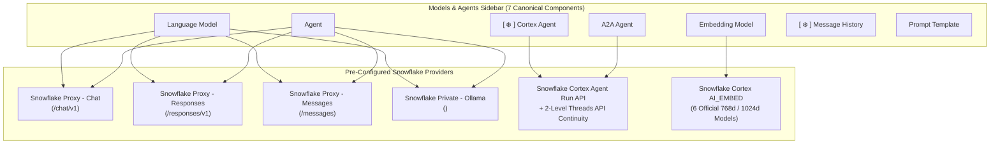
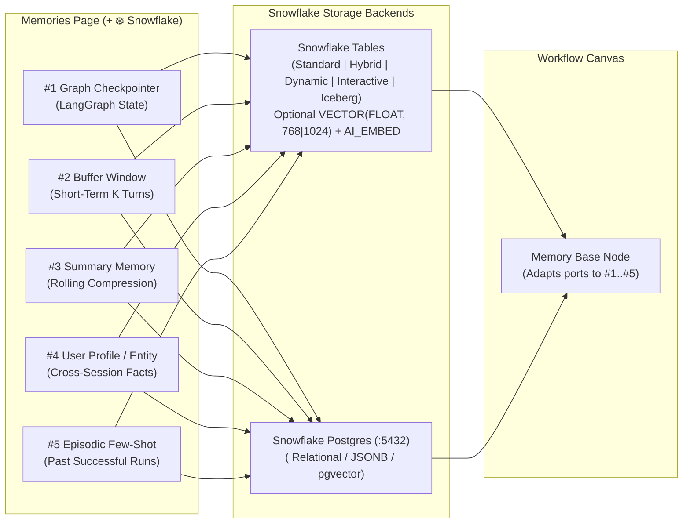

# ❄️ Native Snowflake Langflow

**Snowflake-native governance, Cortex AI, and Snowpark Container Services (SPCS) integration for [Langflow](https://github.com/langflow-ai/langflow) (`v1.12.5` baseline, MIT License).**

> ### ⚠️ Important Notice (Unofficial Personal Fork — Active Testing)
>
> - **Personal Development:** This repository ([`fbattaglieri-snowflake/Native-Snowflake-Langflow`](https://github.com/fbattaglieri-snowflake/Native-Snowflake-Langflow)) is an independent personal development project by **Francesco Battaglieri** ([@fbattaglieri-snowflake](https://github.com/fbattaglieri-snowflake)).
> - **Not Official:** This project is **NOT an official product, release, or repository of Snowflake Inc.**, **nor is it an official project of Langflow / DataStax**. All views, architectural choices, and modifications contained herein belong solely to the author and are not officially supported, endorsed, or warranted by Snowflake Inc. or Langflow.
> - **Open-Source Fork:** This repository is a **public fork** of the upstream open-source project [langflow-ai/langflow](https://github.com/langflow-ai/langflow) (`v1.12.5` baseline, MIT License), extended with the isolated `lfx_snowflake` package to experiment with native execution in Snowpark Container Services (SPCS) and integration with Snowflake services.
> - **Under Active Testing:** This solution is **currently under active testing, qualification, and validation (Work in Progress / Experimental Testing)**. APIs, components, SQL schemas, and configurations may change without notice; do not deploy to production environments without independent qualification and security review.

---

## At a Glance: Why Native Snowflake Langflow?

**Native Snowflake Langflow** keeps 100% of the standard Langflow visual experience while turning every workflow into a **first-class, role-governed Snowflake application** running inside **Snowpark Container Services (SPCS)**.

| Pillar | What It Does | How It Appears in the UI |
|---|---|---|
| **1. Real Snowflake RBAC** | Every SQL query, stage read/write, and Cortex call runs strictly under the user's active Snowflake role (`CURRENT_ROLE()`), never falling back to a service owner role. | **`❄️ Role: [ <ROLE> ▾ ]`** selector in the topbar |
| **2. Per-Flow `[ ❄️ Context ]` Cone** | Each workflow defines its own isolated visibility scope (Databases, Schemas, Tables, Views, Stages, Routines, Cortex Agents, and Snowflake Postgres instances). | **`[ ❄️ Context ]`** button inside the flow editor |
| **3. Native Cortex AI & Multimodal** | Direct visual nodes for `Cortex Agent`, `Cortex Search`, `Cortex Analyst`, `Custom Tool`, `Snowflake Decision`, `AI Redact`, `AI Complete`, and 14 `AI_*` functions over Internal & External Stages. | **`[ ❄️ ]` Components** across the 5 sidebar categories |
| **4. 5 Enterprise Agent Memories** | Built-in support for all 5 LangChain/Langflow memory patterns backed by Snowflake Standard/Hybrid/Iceberg Tables or Snowflake Postgres (`pgvector`). | **`Memories` (`+ ❄️ Snowflake`)** & **`Memory Base`** node |
| **5. Event-Driven Snowflake Triggers** | Native Snowflake `TASK`, `STREAM` (on Table/Stage), and `ALERT` triggers that invoke Langflow workflows directly from Snowflake data changes. | **`Triggers`** sidebar category (`icon="Zap"`) |
| **6. Real-Time SQL Observability** | Every flow run, node span, token count, and RBAC audit event is replicated automatically in real time to Snowflake SQL tables. | **`Flow Activity`** & `<DATABASE>.<SCHEMA>.LANGFLOW_FLOW_ACTIVITY` |

---

## 1. End-to-End Architecture



---

## 2. How Role Governance & Per-Flow `[ ❄️ Context ]` Work

Every workflow has its own **isolated context cone**. Selecting databases, schemas, or objects in **Flow A** never pollutes **Flow B**, and switching the active role in the topbar dynamically computes the intersection between the flow's context and the role's live privileges.

```mermaid
sequenceDiagram
    autonumber
    actor User as User in Browser
    participant UI as Topbar & Canvas Nodes
    participant Bridge as LiveSnowflakeBridge (SPCS)
    participant SF as Snowflake (<SNOWFLAKE_ACCOUNT>)

    User->>UI: 1. Select Active Role (❄️ Role)
    UI->>Bridge: POST /api/v1/snowflake/context (role)
    Bridge->>SF: USE ROLE <ROLE>; SELECT CURRENT_ROLE();
    SF-->>Bridge: Active role verified (context_epoch++)

    User->>UI: 2. Open [ ❄️ Context ] inside /flow/<flow_id>
    UI->>Bridge: Browse Databases ▸ Schemas ▸ Objects + Postgres
    User->>UI: Check allowed Databases / Schemas / Stages / Routines
    UI->>Bridge: Save isolated context for <flow_id>
    Bridge-->>UI: Instantly updates all Canvas Node dropdowns (< 5 ms)

    User->>UI: 3. Run Workflow Node (SQL / AI_* / Custom Tool)
    UI->>Bridge: Execute node with X-Snowflake-Flow-Id
    Bridge->>SF: Verify EXPLAIN_PRIVILEGES & execute under CURRENT_ROLE()
    SF-->>Bridge: Result + Query ID
    Bridge->>SF: Async MERGE INTO <DATABASE>.<SCHEMA>.LANGFLOW_FLOW_ACTIVITY
    Bridge-->>UI: Return result to Canvas / Playground
```

---

## 3. Visual Guide to the Sidebar Categories

All Snowflake components are cleanly integrated into the native Langflow sidebar categories (`1 Component class = 1 Python file`), with zero redundant bottom bundles.

```text
+---------------------------------------------------------------------------------------------------+
|  LANGFLOW SIDEBAR CATEGORIES                                                                      |
|                                                                                                   |
|  1. Input & Output     -> Chat Input, Chat Output, Text Input, Text Output, Webhook (Invariant)   |
|  2. Triggers           -> [❄️] Schedule | [❄️] Table Change | [❄️] Stage File | [❄️] Alert | Webhook |
|  3. Data Sources       -> [❄️] Tables | [❄️] Views | [❄️] Iceberg | [❄️] Postgres | Search | Analyst |
|  4. Models & Agents    -> Language Model | Agent | [❄️] Cortex Agent | A2A | Embedding | History   |
|  5. LLM Operations     -> [❄️] Custom Tool | [❄️] Decision | [❄️] AI Redact | [❄️] AI Complete | ... |
|  6. Files & Knowledge  -> File System | Knowledge | Memory Base | Read File | Write File          |
+---------------------------------------------------------------------------------------------------+
```

---

### 3.1 `LLM Operations` — Cortex AI, Custom Tools & Structured Decisions

The **`LLM Operations`** category combines the 5 native Langflow operations (`Batch Run`, `Guardrails`, `Smart Router`, `Smart Transform`, `Structured Output`) with **7 Snowflake Cortex components**:



| Component (`display_name`) | Class (`name`) | What It Does & Key Capabilities |
|---|---|---|
| **`[ ❄️ ] Custom Tool`** | `SnowflakeCustomTool` | Replicates the Snowsight Cortex Agent **"Add custom tool"** dialog 1:1. Supports `procedure`, scalar `function` (`UDF`), and `table_function` (`UDTF`). Auto-populates parameters from `DESCRIBE PROCEDURE/FUNCTION`, supports manual parameter editing (`+ Add parameter` / `Delete`, `Sort by: Latest added \| Alphabetical \| Required first`), blocks unsupported `OBJECT` parameters, supports `User's default` or `Custom` warehouse + `Query timeout (1–600s)`, and outputs both a Cortex Agent `Tool` (`tool_spec` + `tool_resources`) and direct SQL execution (`CALL` / `SELECT` / `TABLE(...)`). |
| **`[ ❄️ ] Decision`** | `SnowflakeDecision` | Implements official **Snowflake Decision with `AI_COMPLETE`** across the two dedicated models: **`snowflake-decision-fast`** *(Default — low latency, 2–16 `choice` options, 32k token limit)* and **`snowflake-decision`** *(High accuracy, 2–32 `choice` options, 256 KiB JSON limit)*. Supports **1–32 questions per call** (max 256 total options) across **`choice`**, **`score`** (`0..n-1` rubric with weighted average $\sum_{i=0}^{n-1} i \cdot p_i$), and **`noul`** (statement probability in `~0.08–0.92`), normalized confidence $\frac{n \cdot p_{\max} - 1}{n - 1}$, Single-State and Table-Level processing, and **High vs. Low Confidence Routing** outputs. |
| **`[ ❄️ ] AI Redact`** | `SnowflakeAIRedact` | Dedicated PII detection and masking component (`AI_REDACT`) supporting **`redact`**, **`detect`** (with automatic span masking in traces), and **`detect_with_allowlist`** (selective redaction splicing in reverse index order). Covers all **13 official Snowflake PII categories** (`NAME`, `EMAIL`, `PHONE_NUMBER`, `DATE_OF_BIRTH`, `GENDER`, `AGE`, `ADDRESS`, `NATIONAL_ID`, `PASSPORT`, `TAX_IDENTIFIER`, `PAYMENT_CARD_DATA`, `DRIVERS_LICENSE`, `IP_ADDRESS`), enforces the 4,096-token limit via `AI_COUNT_TOKENS('ai_redact', ...)` with automatic `SPLIT_TEXT_RECURSIVE_CHARACTER` chunking, and supports pre-conversion from stage documents/audio. |
| **`[ ❄️ ] AI Complete`** | `SnowflakeAIComplete` | Generative `AI_COMPLETE` node supporting text prompts, `model_parameters`, forced JSON schema output (`response_format`), and **direct multimodal inputs (`TO_FILE` & `DIRECTORY(@stage)`)** from Internal Stages and External Buckets (`S3`, `GCS`, `Azure`) for **images**, **`.mp3`/audio**, and **video** (including `gemini-3.1-pro`, `gemini-3.1-flash-lite`, `gemini-3.5-flash`). |
| **`[ ❄️ ] AI Function`** | `SnowflakeAIFunction` | Unified node for the **14 task-specific Cortex AI Functions**: `AI_CLASSIFY`, `AI_FILTER`, `AI_EXTRACT`, `AI_SENTIMENT`, `AI_SUMMARIZE`, `AI_SUMMARIZE_AGG`, `AI_AGG`, `AI_TRANSLATE`, `AI_SIMILARITY`, `AI_TRANSCRIBE` (with `word`/`speaker` timestamps on `.mp3`/audio/video), `AI_PARSE_DOCUMENT` (`LAYOUT`/`OCR`), `AI_EMBED`, `AI_MULTI_EMBED` (`twelvelabs-marengo-embed-3-0` on image/audio/video), and `AI_COUNT_TOKENS`, reading from both tables and **Internal / External Stages**. |
| **`[ ❄️ ] SQL Statement`** | `SnowflakeSQLStatement` | Executes governed parameterized SQL (`SELECT`, `CALL`) within `<DATABASE>.<SCHEMA>` under `CURRENT_ROLE()`, returning either a `DataFrame` or structured `JSON` (`OBJECT_CONSTRUCT(*)`). |
| **`[ ❄️ ] Operations`** | `SnowflakeLLMNode` | Multi-operation Snowflake Cortex and SQL utility node synchronized with the active flow context. |

---

### 3.2 Multimodal Stage & Cloud Bucket Support (`Internal` & `External`)

Both **`[ ❄️ ] AI Function`** and **`[ ❄️ ] AI Complete`** read media files directly from **Internal Stages** (`SNOWFLAKE_SSE` / `SNOWFLAKE_FULL`) and **External Cloud Stages** (`Amazon S3`, `Google Cloud Storage`, `Microsoft Azure`, `S3-Compatible`) enabled in `[ ❄️ Context ]`:

| Media Category | Supported Extensions | Enabled Cortex Functions | Execution Modes |
|---|---|---|---|
| **Images** | `.jpg`, `.jpeg`, `.png`, `.webp`, `.gif`, `.bmp` | `AI_COMPLETE`, `AI_CLASSIFY`, `AI_FILTER`, `AI_EXTRACT`, `AI_SUMMARIZE`, `AI_SIMILARITY`, `AI_PARSE_DOCUMENT`, `AI_EMBED`, `AI_MULTI_EMBED` | Single/Multi-file `TO_FILE('@<DATABASE>.<SCHEMA>.<STAGE_NAME>', '<path>')` or Batch `DIRECTORY(@<DATABASE>.<SCHEMA>.<STAGE_NAME>)` |
| **Audio / `.mp3`** | `.mp3`, `.wav`, `.flac`, `.m4a`, `.ogg`, `.aac`, `.webm`, `.mp4` | `AI_TRANSCRIBE` (`word` / `speaker` timestamps), `AI_COMPLETE` (`gemini-3.1-pro`, `gemini-3.1-flash-lite`, `gemini-3.5-flash`), `AI_MULTI_EMBED` (`twelvelabs-marengo-embed-3-0`) | Single file `TO_FILE(...)` or Batch `DIRECTORY(@...)` |
| **Video** | `.mp4`, `.mov`, `.webm`, `.mkv`, `.avi`, `.flv`, `.mpeg`, `.mpg`, `.wmv`, `.3gpp`, `.ogv` | `AI_COMPLETE` (scene & audio analysis), `AI_TRANSCRIBE` (audio track extraction), `AI_MULTI_EMBED` (`visual`, `audio`, `transcription` embeddings) | Single file `TO_FILE(...)` or Batch `DIRECTORY(@...)` |
| **Documents** | `.pdf`, `.docx`, `.pptx`, `.html`, `.txt`, `.md`, `.eml`, `.tiff` | `AI_PARSE_DOCUMENT` (`LAYOUT` / `OCR`, `page_split`), `AI_EXTRACT`, `AI_SUMMARIZE` | Single file `TO_FILE(...)` or Batch `DIRECTORY(@...)` |

---

### 3.3 `Models & Agents` — 4 Snowflake Model Providers, Cortex Agents & A2A



- **Dynamic Reasoning Controls:** Selecting a reasoning-capable model under `Snowflake Proxy - Chat`, `Responses`, or `Messages` automatically reveals `Reasoning Effort` or `Extended Thinking` (`Thinking Budget Tokens`) directly below the model selector while hiding API key fields (handled by SPCS).
- **2-Level Cortex Agent Threads:** `[ ❄️ ] Cortex Agent` preserves multi-turn conversation state across turns using a local SQLite thread cache (`0 ms` overhead) backed by the Snowflake Cortex `Threads API` (`/api/v2/cortex/threads`).

---

### 3.4 `Files & Knowledge`, `Memories (#1..#5)` & `Stages & Volumes`

The left navigation rail includes dedicated views for **`Memories`** (with the **`[ + ❄️ Snowflake ]`** wizard, which automatically dismisses transient popovers on tab switch, outside click, or `Escape`) and **`Stages & Volumes`** (Bucket icon above `Traces`).



---

### 3.5 `Triggers` — Event-Driven & Scheduled Snowflake Execution

Positioned immediately after `Input & Output`, the **`Triggers`** category provides **5 specialized components** powered by the SPCS Service Function `<DATABASE>.<SCHEMA>.RUN_LANGFLOW_FLOW(flow_id, trigger_payload)`:

| Trigger Component | Snowflake Primitive | When It Fires |
|---|---|---|
| **`[ ❄️ ] Schedule Trigger`** | `CREATE OR ALTER TASK ... SCHEDULE = 'USING CRON ...'` | Time-based cron or interval schedules (`Minutes`, `Hours`, `Days`, `Weeks`, `Months`). |
| **`[ ❄️ ] Table Change Trigger`** | `CREATE STREAM ON TABLE/VIEW` + Triggered Task `WHEN SYSTEM$STREAM_HAS_DATA(...)` | Row inserts/updates/deletes (CDC) on any table or view in `[ ❄️ Context ]`. |
| **`[ ❄️ ] Stage File Trigger`** | `DIRECTORY = (ENABLE = TRUE)` + `CREATE STREAM ON STAGE` + Triggered Task | New or updated files arriving on `@<DATABASE>.<SCHEMA>.<STAGE_NAME>`. |
| **`[ ❄️ ] Condition Alert Trigger`** | `CREATE OR ALTER ALERT ... IF (EXISTS (<sql>))` | SQL threshold or anomaly conditions evaluated periodically or on new data. |
| **`Webhook`** | Native HTTP Webhook Endpoint | External HTTP POST payloads (`WEBHOOK_RUN`). |

---

### 3.6 `Data Sources` — Governed Business Data & Semantic Models

| Component | Hierarchy in Node | Description |
|---|---|---|
| **`[ ❄️ ] Tables`** | `Database -> Schema -> Table Type -> Table` | Reads `Standard`, `Hybrid`, `Dynamic`, and `Interactive` tables in `[ ❄️ Context ]`. |
| **`[ ❄️ ] Views`** | `Database -> Schema -> View Type -> View` | Reads `Standard`, `Secure`, and `Materialized` views in `[ ❄️ Context ]`. |
| **`[ ❄️ ] Iceberg Tables`** | `Database -> Schema -> Iceberg Table` | Reads Apache Iceberg tables managed in Snowflake. |
| **`[ ❄️ ] Postgres`** | `Postgres Instance -> Table / Query` | Account-level connection to `<POSTGRES_INSTANCE>` (`:5432`). |
| **`[ ❄️ ] Cortex Search`** | `Database -> Schema -> Search Service` | Queries Cortex Search services (also usable as an Agent `StructuredTool`). |
| **`[ ❄️ ] Cortex Analyst`** | `Database -> Schema -> Semantic View / @Stage YAML` | Natural-language-to-SQL via Cortex Analyst Semantic Views or stage YAML models. |

---

## 4. Tested Cloud Environment & Parametric Placeholders

**Tested Cloud Environment: AWS — Snowflake on AWS**

This solution has been architected, developed, and verified on **Snowflake on AWS** (Amazon Web Services) using Snowpark Container Services (SPCS), Snowflake Postgres, Snowflake Cortex AI Functions (`AI_*`), Cortex Analyst, Cortex Search, and Cortex Agent Run APIs. Where cross-region Cortex model inference is required on AWS deployments, configure:

```sql
ALTER ACCOUNT SET CORTEX_ENABLED_CROSS_REGION = 'ANY_REGION';
```

All configuration files, SQL scripts, and container specifications in this repository are **100% account-agnostic** and parameterized via the following placeholders:

| Placeholder | Description |
|---|---|
| `<SNOWFLAKE_ACCOUNT>` | Target Snowflake account identifier |
| `<DATABASE>` | Target Snowflake database for Langflow objects and telemetry |
| `<SCHEMA>` | Target Snowflake schema for tables, stages, and services |
| `<COMPUTE_POOL>` | SPCS Compute Pool hosting the Langflow container service |
| `<IMAGE_REPOSITORY>` | SPCS Image Repository FQN (`<DATABASE>.<SCHEMA>.<IMAGE_REPOSITORY>`) |
| `<STAGE_NAME>` | Internal or External Named Stage (`<DATABASE>.<SCHEMA>.<STAGE_NAME>`) |
| `<POSTGRES_INSTANCE>` | Snowflake Postgres instance name for ORM persistence / `pgvector` |
| `<LLM_PROXY_BASE_URL>` | Base URL of the Standard LLM Proxy service (`Chat`, `Responses`, `Messages`) |
| `<OLLAMA_BASE_URL>` | Base URL of the Snowflake-hosted Ollama service |

---

## 5. Architecture Decision Records & Documentation Index

| Document | Purpose |
|---|---|
| [`docs/CAPABILITY_MATRIX.md`](docs/CAPABILITY_MATRIX.md) | Visual capability overview, component inventory, and qualification matrix (`Q1..Q4`, `REQ-01..REQ-17`, Wave 2 enhancements) |
| [`docs/DEPLOYMENT_SPCS.md`](docs/DEPLOYMENT_SPCS.md) | Step-by-step Snowpark Container Services (SPCS) deployment guide and SQL setup |
| [`docs/UPSTREAM_SYNC.md`](docs/UPSTREAM_SYNC.md) | Governance rules (`RULE-SYNC-01..07`) for synchronizing with `langflow-ai/langflow` |
| [`docs/ADR/ADR-001.md`](docs/ADR/ADR-001.md) .. [`ADR-007.md`](docs/ADR/ADR-007.md) | Architecture Decision Records covering UI invariants, active-role RBAC, fail-closed authorization, object provisioning, multi-protocol LLM proxy, and SQL trace replication |

---

## 6. Upstream Update & Synchronization Rules (`langflow-ai/langflow`)

Because this repository is a fork of [`langflow-ai/langflow`](https://github.com/langflow-ai/langflow), all updates from upstream follow the governance rules documented in [`docs/UPSTREAM_SYNC.md`](docs/UPSTREAM_SYNC.md) and enforced by [`scripts/sync_upstream.sh`](scripts/sync_upstream.sh):

1. **`RULE-SYNC-01` — Read-Only Upstream Remote:** `upstream` (`https://github.com/langflow-ai/langflow.git`) is strictly read-only; all fork commits and tags are pushed exclusively to `origin` (`snowflake/main` or scoped `feat/*` / `sync/upstream-*` branches).
2. **`RULE-SYNC-02` — Stable Release Tag Pinning Only:** Never merge arbitrary untagged commits from upstream `main`. Always synchronize against an explicit upstream release tag (e.g., `v1.12.5` → next stable tag).
3. **`RULE-SYNC-03` — Dedicated Staging Branch (`sync/upstream-<tag>`):** Every upstream update is staged on `sync/upstream-<tag>` via `bash scripts/sync_upstream.sh <tag>` before any fast-forward/merge into `snowflake/main`.
4. **`RULE-SYNC-04` — Strict `lfx_snowflake` Bundle Isolation & 6 Tracked Hook Points:** Keep 95%+ of Snowflake logic inside `src/lfx_snowflake/`, `frontend_patches/`, `sql/`, and `docs/`. Verify that the 6 tracked core hook points and invariant categories (`Input & Output`, `Prompt Template`, `Processing`, `Flow Control`, `LLM Selector`, `Calculator`, `Current Date`) remain intact.
5. **`RULE-SYNC-05` — Mandatory Pre-Commit & CI Sanitization Gate:** `python3 scripts/verify_public_repo_sanitization.py` must pass with **0 secrets** and **0 denylist matches** across all working-tree files and Git commit history before pushing.
6. **`RULE-SYNC-06` — Full Regression & Multi-Protocol Qualification Gate:** The full `pytest` suite (`tests/`) covering RBAC role switching, 3 Proxy Standard protocols (`Chat`, `Responses`, `Messages`), Ollama, AI Functions, and SQL trace replication must pass 100%.
7. **`RULE-SYNC-07` — Pre-Upgrade Quiesced Backup & Atomic Rollback:** Before deploying an updated image to `<COMPUTE_POOL>`, run `python3 scripts/backup_restore_lifecycle.py` (or create a point-in-time fork of `<POSTGRES_INSTANCE>`) so both container image and ORM schema can be rolled back atomically.

---

## 7. Verification & Sanitization Gate

Run the automated sanitization gate and test suite before any commit or push:

```bash
python3 scripts/verify_public_repo_sanitization.py
pytest
```
