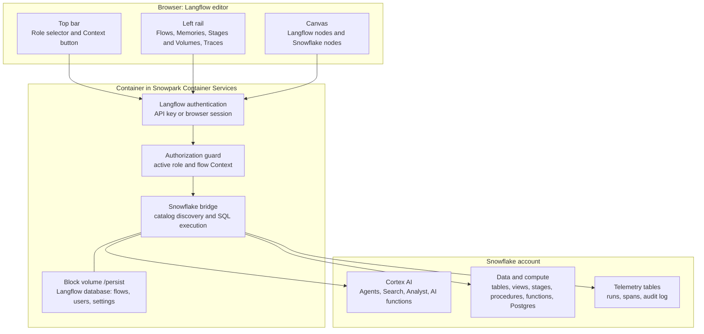
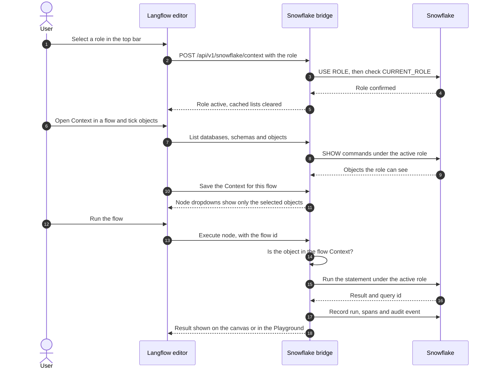
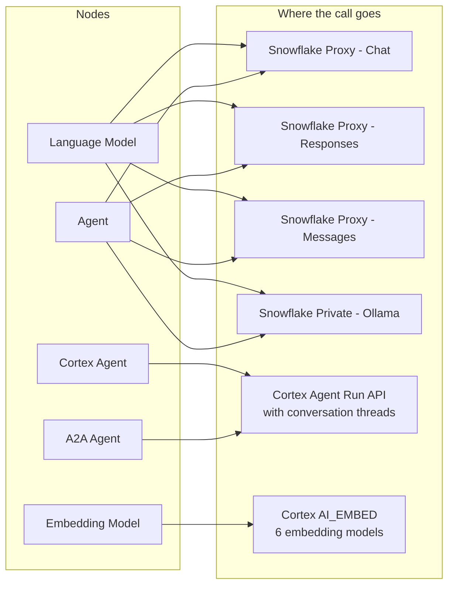
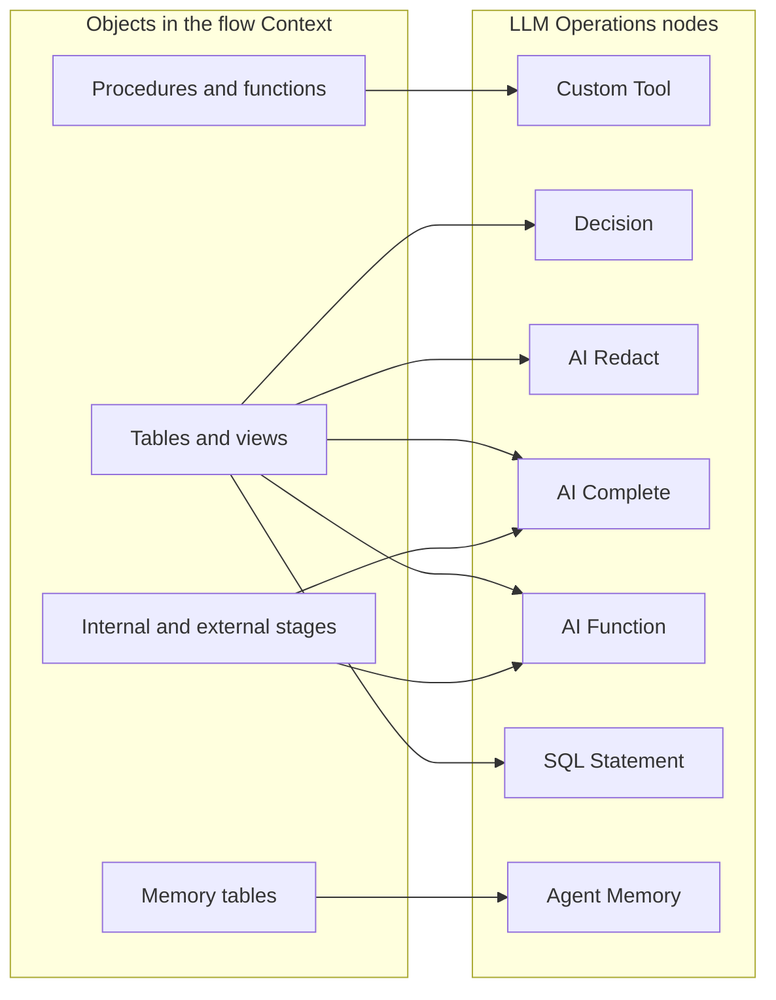
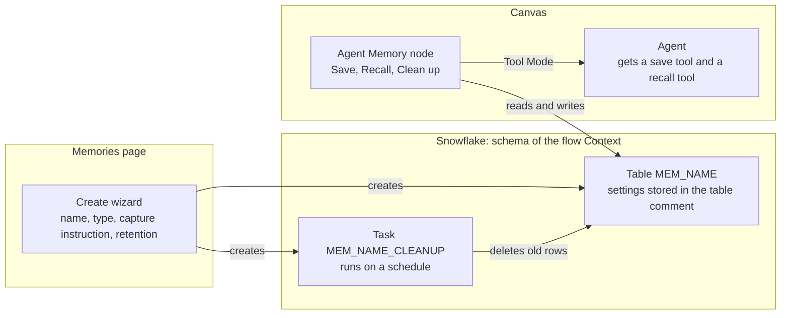

<div align="center">

# Native Snowflake Langflow

**Langflow, running inside Snowflake, working on Snowflake data under Snowflake roles.**

[](LICENSE)
[](https://www.python.org/)
[](https://docs.snowflake.com/)
[](https://github.com/langflow-ai/langflow)

</div>

> [!WARNING]
> **Unofficial personal fork, under active testing.** This repository ([`fbattaglieri-snowflake/Native-Snowflake-Langflow`](https://github.com/fbattaglieri-snowflake/Native-Snowflake-Langflow)) is an independent project by **Francesco Battaglieri** ([@fbattaglieri-snowflake](https://github.com/fbattaglieri-snowflake)). It is **NOT an official product, release, or repository of Snowflake Inc.**, nor is it an official project of Langflow / DataStax, and it is not supported or warranted by either. APIs, components, SQL schemas, and configuration may change without notice. Do not deploy to production without your own qualification and security review.

> [!TIP]
> This is a public fork of [langflow-ai/langflow](https://github.com/langflow-ai/langflow) released under the **MIT License**. It contains only the Snowflake extension code (the `lfx_snowflake` package, the installer, SQL and docs), not the upstream source. The release image is built on the official `langflowai/langflow:1.13.1` image, pinned by digest.

**Current version: v0.8.6** — see the [changelog](#changelog).

## Contents

1. [What this project is](#1-what-this-project-is)
2. [Architecture](#2-architecture)
3. [Roles and the per-flow Context](#3-roles-and-the-per-flow-context)
4. [Components on the canvas](#4-components-on-the-canvas)
5. [Memory](#5-memory)
6. [Stages & Volumes](#6-stages--volumes)
7. [Observability](#7-observability)
8. [Showcase flows](#8-showcase-flows)
9. [Deploying](#9-deploying)
10. [Tested environment and placeholders](#10-tested-environment-and-placeholders)
11. [Repository layout](#11-repository-layout)
12. [Security of this repository](#12-security-of-this-repository)
13. [Upgrading Langflow](#13-upgrading-langflow)
14. [Known limitations](#14-known-limitations)
15. [Documentation index](#15-documentation-index)

---

## 1. What this project is

[Langflow](https://github.com/langflow-ai/langflow) is a visual editor for building AI workflows: you drag nodes onto a canvas, connect them, and run the result as a chat or an API.

This project keeps the Langflow editor as it is and adds what is needed to use it **inside a Snowflake account**:

- It runs as a container in **Snowpark Container Services (SPCS)**, so data does not leave Snowflake.
- Every query runs under a **Snowflake role** chosen in the top bar. If the role cannot do something, the node fails with a clear error. Nothing falls back to a more powerful role.
- Each flow has its own **Context**: the list of databases, schemas and objects that flow may use.
- The canvas gets **Snowflake nodes**: tables, views, Cortex Search, Cortex Analyst, Cortex Agents, the `AI_*` functions, stored procedures and functions as tools, triggers, and memory.
- Flow runs are written to **Snowflake tables**, so they can be queried with SQL.

### What you get

| Area | What it does | Where you see it | Status |
|---|---|---|---|
| Role selector | Runs every Snowflake call under the selected role | `Role` selector in the top bar | Live |
| Per-flow Context | Limits each flow to the objects selected for it | `Context` button in the flow editor | Live |
| Cortex AI nodes | Cortex Agent, Search, Analyst, `AI_COMPLETE`, `AI_REDACT`, Decision models, 14 `AI_*` functions, files on stages | Sidebar categories | Live |
| Model providers | `Language Model` and `Agent` use models served by an LLM proxy or by Ollama, both hosted in SPCS | `Models & Agents` | Live |
| Triggers | Start a flow from a schedule, a table change, a new file on a stage, or an alert | `Triggers` category | Live |
| Memory | Tables in Snowflake that agents save to and recall from, with automatic cleanup | `Memories` page, `Agent Memory` node | Live |
| Chat history | Conversation turns stored in a Snowflake table | `Message History` node | Live |
| Stages & Volumes | Lists internal and external stages from Snowflake; creates stages | `Stages & Volumes` page | Live (file upload: not available) |
| Observability | Runs, spans and audit events stored in Snowflake tables | `Traces` page, SQL tables | Live |
| Caller's rights | Runs queries as the signed-in user instead of the service | Environment variable | Implemented, off by default |

"Live" means deployed and tested on the environment described in [section 10](#10-tested-environment-and-placeholders). See [Known limitations](#14-known-limitations) for what is not done.

---

## 2. Architecture

Three layers: the browser, the container in SPCS, and Snowflake.



| Part | Role |
|---|---|
| Langflow editor | The standard Langflow UI, with a role selector, a Context button and two extra pages (`Memories`, `Stages & Volumes`). |
| Authorization guard | Checks every Snowflake call against the active role and the flow Context before it runs. Fails closed. |
| Snowflake bridge | The only component that talks to Snowflake. It lists objects, runs SQL through the Snowflake SQL API, and calls the Cortex REST APIs. |
| Block volume `/persist` | Holds Langflow's own database (flows, users, settings) so it survives restarts and upgrades. |
| Telemetry tables | `LANGFLOW_FLOW_RUNS`, `LANGFLOW_FLOW_SPANS`, `LANGFLOW_AUDIT_LOG`, `LANGFLOW_FLOW_ACTIVITY` in `<DATABASE>.<SCHEMA>`. |

All Snowflake logic lives in one Python package, `src/lfx_snowflake/`. It is added to the official Langflow image at build time by an installer that stops the build if Langflow has changed in a way it does not expect.

---

## 3. Roles and the per-flow Context

Two things decide what a node can touch:

1. **The active role.** Chosen in the top bar. Only roles granted to the user are listed. Secondary roles are turned off (`USE SECONDARY ROLES NONE`), so the active role is the only source of privileges.
2. **The flow Context.** Opened with the `Context` button inside a flow. You tick the databases, schemas and objects the flow may use. Node dropdowns then show only those objects, and SQL that touches anything else is refused.

A node can use an object only if **both** allow it. Each flow has its own Context: a selection made in one flow does not affect another.



When something is not allowed, the API returns one of four error codes:

| Code | Meaning |
|---|---|
| `AUTHZ_ROLE_DENIED` | The active role lacks the privilege. |
| `OBJECT_NOT_FOUND_OR_UNAUTHORIZED` | The object does not exist or the role cannot see it. |
| `UNSUPPORTED_CAPABILITY` | The request asks for something this project does not implement. |
| `TECHNICAL_EXECUTION_ERROR` | Snowflake returned an error while executing. |

---

## 4. Components on the canvas

Snowflake nodes are placed in the standard Langflow sidebar categories. Nodes marked with ❄️ are added by this project; the others are Langflow's own, extended where noted.

| Sidebar category | Nodes |
|---|---|
| Input & Output | Langflow's own nodes, unchanged |
| Triggers | ❄️ Schedule Trigger, ❄️ Table Change Trigger, ❄️ Stage File Trigger, ❄️ Condition Alert Trigger, Webhook |
| Data Sources | ❄️ Tables, ❄️ Views, ❄️ Iceberg Tables, ❄️ Postgres, ❄️ Cortex Search, ❄️ Cortex Analyst |
| Models & Agents | Language Model, Agent, ❄️ Cortex Agent, A2A Agent, Embedding Model, ❄️ Message History, Prompt Template |
| LLM Operations | Langflow's five nodes, plus ❄️ Custom Tool, ❄️ Decision, ❄️ AI Redact, ❄️ AI Complete, ❄️ AI Function, ❄️ SQL Statement, ❄️ Agent Memory, ❄️ Operations |
| Files & Knowledge | File System, Knowledge, Memory Base, Read File, Write File |

`Processing`, `Flow Control`, `LLM Selector`, `Calculator` and `Current Date` are not modified.

### 4.1 Triggers

A trigger starts a flow from inside Snowflake. Each one creates a Snowflake object that calls the service function `<DATABASE>.<SCHEMA>.RUN_LANGFLOW_FLOW(flow_id, trigger_payload)`.

| Node | Snowflake object it creates | Fires when |
|---|---|---|
| ❄️ Schedule Trigger | Task with a cron or interval schedule | The schedule is due |
| ❄️ Table Change Trigger | Stream on a table or view, plus a triggered task | Rows are inserted, updated or deleted |
| ❄️ Stage File Trigger | Directory table and stream on a stage, plus a triggered task | A file arrives or changes on `@<DATABASE>.<SCHEMA>.<STAGE_NAME>` |
| ❄️ Condition Alert Trigger | Alert with a SQL condition | The condition returns rows |
| Webhook | None (Langflow HTTP endpoint) | An external system sends an HTTP POST |

### 4.2 Data Sources

| Node | You choose | What it returns |
|---|---|---|
| ❄️ Tables | Database, schema, table type, table | Rows from standard, hybrid, dynamic or interactive tables |
| ❄️ Views | Database, schema, view type, view | Rows from standard, secure or materialized views |
| ❄️ Iceberg Tables | Database, schema, table | Rows from Iceberg tables managed in Snowflake |
| ❄️ Postgres | Postgres instance, table or query | Rows from Snowflake Postgres (`<POSTGRES_INSTANCE>`) |
| ❄️ Cortex Search | Database, schema, search service | Search results from a Cortex Search service |
| ❄️ Cortex Analyst | Database, schema, semantic view or YAML on a stage | An answer to a question in plain language, with the generated SQL |

All of them can be switched to **Tool Mode**, so a Langflow `Agent` can call them as tools.

### 4.3 Models & Agents

`Language Model` and `Agent` are Langflow's own nodes. This project registers four extra model providers for them. The model lists are read from the provider, so a model added to the proxy appears in the node within about a minute, with no new release.



| Provider | Endpoint |
|---|---|
| Snowflake Proxy - Chat | `<LLM_PROXY_BASE_URL>/chat/v1` |
| Snowflake Proxy - Responses | `<LLM_PROXY_BASE_URL>/responses/v1` |
| Snowflake Proxy - Messages | `<LLM_PROXY_BASE_URL>/messages` |
| Snowflake Private - Ollama | `<OLLAMA_BASE_URL>` |

- **No API keys in the UI.** The container authenticates to the proxy with its SPCS identity.
- **Reasoning controls.** When the selected model supports it, `Reasoning Effort` or `Extended Thinking` appears under the model selector.
- **Cortex Agent.** Calls an existing Cortex Agent and keeps the conversation thread across turns.
- **A2A Agent.** Calls another flow published as an A2A agent, a Cortex Agent, or an external A2A URL. A flow can also be served as an A2A agent.
- **Message History.** Stores and reads chat turns in a Snowflake table (`LANGFLOW_MESSAGES_TABLE`).

The LLM proxy and Ollama are separate services. They are not part of this repository; you point this project at them with the two base URLs.

### 4.4 LLM Operations



| Node | Class | What it does |
|---|---|---|
| ❄️ Custom Tool | `SnowflakeCustomTool` | Turns a stored procedure, a function (UDF) or a table function (UDTF) into a tool. Parameters are read with `DESCRIBE`; you can edit them, choose a warehouse and set a timeout (1–600 s). It can run the routine directly or hand it to an agent as a tool. |
| ❄️ Decision | `SnowflakeDecision` | Asks a Snowflake decision model (`snowflake-decision-fast` by default, or `snowflake-decision`) to choose an option, give a score, or rate a statement. Returns a confidence value and has separate outputs for high and low confidence, so the flow can branch. |
| ❄️ AI Redact | `SnowflakeAIRedact` | Finds or masks personal data with `AI_REDACT` (13 categories such as name, email, phone, address, payment card). Long texts are split automatically to respect the token limit. |
| ❄️ AI Complete | `SnowflakeAIComplete` | Calls `AI_COMPLETE` with a prompt. Can force a JSON schema for the answer and can read images, audio, video and documents from a stage. |
| ❄️ AI Function | `SnowflakeAIFunction` | One node for 14 task functions: `AI_CLASSIFY`, `AI_FILTER`, `AI_EXTRACT`, `AI_SENTIMENT`, `AI_SUMMARIZE`, `AI_SUMMARIZE_AGG`, `AI_AGG`, `AI_TRANSLATE`, `AI_SIMILARITY`, `AI_TRANSCRIBE`, `AI_PARSE_DOCUMENT`, `AI_EMBED`, `AI_MULTI_EMBED`, `AI_COUNT_TOKENS`. Works on table columns and on files in stages. |
| ❄️ SQL Statement | `SnowflakeSQLStatement` | Runs a `SELECT` or `CALL` with `?` placeholders. Values can come from other nodes through the `Bind Values` port; they are bound, never pasted into the SQL text. |
| ❄️ Agent Memory | `SnowflakeAgentMemory` | Saves to, recalls from and cleans up a memory table. See [Memory](#5-memory). |
| ❄️ Operations | `SnowflakeLLMNode` | General helper node for Cortex and SQL operations. |

Model availability depends on your Snowflake region. See the [Snowflake documentation](https://docs.snowflake.com/) for the models each function supports.

### 4.5 Files in stages

`AI Complete` and `AI Function` read files directly from stages selected in the flow Context, both internal stages and external stages (Amazon S3, Google Cloud Storage, Azure, S3-compatible).

| File type | Extensions | Typical use |
|---|---|---|
| Images | `.jpg`, `.jpeg`, `.png`, `.webp`, `.gif`, `.bmp` | Describe, classify, extract fields, embed |
| Audio | `.mp3`, `.wav`, `.flac`, `.m4a`, `.ogg`, `.aac` | Transcribe with word or speaker timestamps |
| Video | `.mp4`, `.mov`, `.webm`, `.mkv`, `.avi` | Describe scenes, transcribe the audio track, embed |
| Documents | `.pdf`, `.docx`, `.pptx`, `.html`, `.txt`, `.md`, `.eml`, `.tiff` | Parse layout or OCR, extract fields, summarize |

Two ways to pick files: one file with `TO_FILE('@<DATABASE>.<SCHEMA>.<STAGE_NAME>', '<path>')`, or every file in a stage with `DIRECTORY(@<DATABASE>.<SCHEMA>.<STAGE_NAME>)`.

### 4.6 Files & Knowledge

| Node | What it does | Status |
|---|---|---|
| File System | Browses files on stages | In progress |
| Read File | Reads a file from a stage, optionally parsing it with `AI_PARSE_DOCUMENT` | In progress |
| Write File | Writes or appends to a file on a stage | In progress |
| Knowledge | Builds a searchable knowledge base (parse, split, index with Cortex Search) | In progress |
| Memory Base | Memory fed automatically from chat turns; stored in `LF_MEM_*` tables | Live |

"In progress" means the node exists but has not been fully verified end to end.

---

## 5. Memory

There are three kinds of memory. They solve different problems.

| You want | Use | Stored in |
|---|---|---|
| The chat to remember earlier turns | `Message History` node | Table set in `LANGFLOW_MESSAGES_TABLE` |
| Memories extracted automatically from every chat turn | `Memory Base` node | `LF_MEM_*` tables |
| An agent or a flow that decides what to save and what to recall | `Agent Memory` node | `MEM_<NAME>` table in the flow Context |

The rest of this section is about the third kind, called **typed memory**.

### 5.1 How typed memory works



1. **Create it.** On the `Memories` page, click `+ Snowflake`, pick a type and a name. This creates a real table `MEM_<NAME>` in the database and schema of the flow Context, and a task `MEM_<NAME>_CLEANUP` that enforces retention.
2. **Use it.** Put an `Agent Memory` node on the canvas and select the memory. The node has three actions: **Save**, **Recall** and **Clean up**.
3. **Let an agent use it.** Switch the node to Tool Mode and connect it to an `Agent`. The agent gets two tools, `save_<name>` and `recall_<name>`. The **capture instruction** you wrote in the wizard becomes the description of the save tool: that is how the agent knows what is worth saving.
4. **Cleanup is automatic.** The task runs on a cron schedule (default: every day at 03:00 UTC) and removes rows that are too old or beyond the row limit. You can also run it on demand from the node.

The settings of a memory are stored in the comment of its table. After a restart the memories are read back from Snowflake, so nothing depends on the container's memory.

### 5.2 Memory types

| Type | What it holds | Typical use |
|---|---|---|
| Graph state checkpointer | The state of a run, step by step | Save intermediate results and resume or pass them to the next step |
| Summary memory | One running summary per session | Keep long conversations short |
| User profile / entity memory | Facts about a user or an entity, across sessions | Preferences, account details |
| Episodic memory | Past cases and their outcome | "What did we do last time this happened?" Optional similarity search with `AI_EMBED` |

For episodic memory, rows saved with a `Key` are recalled only for that key. Without a key the memory is shared by all sessions.

### 5.3 What is refused

The wizard creates **standard** or **hybrid** tables only. These requests are refused with `422 UNSUPPORTED_CAPABILITY` instead of being registered without a real object:

- memories on Snowflake Postgres, dynamic, interactive or Iceberg tables, or on Cortex Search;
- a chat-window memory (use `Message History`);
- embeddings from a provider other than Cortex.

If a hybrid table cannot be created, the request fails. It does not fall back to a standard table.

---

## 6. Stages & Volumes

The `Stages & Volumes` page lists the internal and external stages the active role can see, read from Snowflake. From it you can create a stage or an external volume.

- Creation runs the real `CREATE STAGE` or `CREATE EXTERNAL VOLUME`. If Snowflake returns an error, the error is shown and nothing is registered.
- For external locations the URL, the storage integration or the role ARN must be provided. They are never filled in with defaults.
- Credentials are never accepted in a URL.
- **File upload from the browser is not available.** The bridge uses the Snowflake SQL API, which cannot run `PUT`. The upload endpoint returns `501`. Load files with Snowsight, SnowSQL or the Snowflake CLI.

---

## 7. Observability

Every run is recorded in Snowflake tables in `<DATABASE>.<SCHEMA>`:

| Table | Content |
|---|---|
| `LANGFLOW_FLOW_RUNS` | One row per flow execution: flow, role, status, timing |
| `LANGFLOW_FLOW_SPANS` | One row per node execution, with Snowflake query ids |
| `LANGFLOW_AUDIT_LOG` | Append-only log: object creation, role changes, denied operations |
| `LANGFLOW_FLOW_ACTIVITY` | Summary shown in the `Traces` page |

Secrets and personal data are redacted before a row is written. Every HTTP response carries a request id (`X-Request-Id` and `X-Snowflake-Langflow-Request-Id`) that can be joined with the audit log and with the Snowflake `QUERY_TAG`.

---

## 8. Showcase flows

Four reference flows show the nodes working together. Build them with the Langflow Flows API in any project; object names are placeholders.

| Flow | What it shows |
|---|---|
| `SHOWCASE_01_Multi_Cortex_Agents_All_DataSources` | Several `Cortex Agent` nodes in sequence, fed by tables, views, Iceberg tables and a stage listing |
| `SHOWCASE_02_Langflow_Agent_All_Snowflake_Tools` | A Langflow `Agent` on a proxy model with the Snowflake nodes in Tool Mode, also exposed through the project MCP server |
| `SHOWCASE_03_Language_Model_Tools_Analyst_Search_AIFunctions_Decision` | `Language Model`, `Cortex Analyst`, `Cortex Search`, AI functions and a `Decision` node: only the chosen branch runs |
| `SHOWCASE_04_A2A_All_Forms_Internal_External_And_CortexBridge` | A flow served as an A2A agent that calls three `A2A Agent` nodes (another flow, a Cortex Agent, an external URL) |

---

## 9. Deploying

The full procedure is in [`docs/DEPLOYMENT_SPCS.md`](docs/DEPLOYMENT_SPCS.md). In short:

1. **Prepare Snowflake.** Run the scripts in `sql/` to create roles, grants and the telemetry tables.
2. **Build the image.** `Dockerfile.release` starts from the official Langflow image and runs the installer once.
3. **Push the image** to your SPCS image repository.
4. **Create the service** from `service-spec.template.yaml` after replacing the placeholders.
5. **Grant access** to the service endpoint to the roles that should use it.

```bash
docker build --platform linux/amd64 -f Dockerfile.release \
  -t <SNOWFLAKE_ACCOUNT>.registry.snowflakecomputing.com/<DATABASE>/<SCHEMA>/<IMAGE_REPOSITORY>/snowflake-langflow:<VERSION> .
docker push <SNOWFLAKE_ACCOUNT>.registry.snowflakecomputing.com/<DATABASE>/<SCHEMA>/<IMAGE_REPOSITORY>/snowflake-langflow:<VERSION>
```

```sql
CREATE SERVICE <DATABASE>.<SCHEMA>.SNOWFLAKE_LANGFLOW_SERVICE
  IN COMPUTE_POOL <COMPUTE_POOL>
  FROM SPECIFICATION_FILE = '@<DATABASE>.<SCHEMA>.<STAGE_NAME>/service-spec.yaml';
```

Keep secrets out of the service specification: use Snowflake secrets and reference them from the spec.

---

## 10. Tested environment and placeholders

**Tested Cloud Environment: AWS — Snowflake on AWS**

The project was developed and tested on **Snowflake on AWS**, using Snowpark Container Services, Snowflake Postgres, the Cortex AI functions, Cortex Analyst, Cortex Search and the Cortex Agent API. Other clouds have not been tested. If a model is not available in your region, cross-region inference can be enabled:

```sql
ALTER ACCOUNT SET CORTEX_ENABLED_CROSS_REGION = 'ANY_REGION';
```

Nothing in this repository names a specific account. Every file uses these placeholders, which you replace with your own values:

| Placeholder | Meaning |
|---|---|
| `<SNOWFLAKE_ACCOUNT>` | Your Snowflake account identifier |
| `<DATABASE>` | Database for the service, its tables and its stages |
| `<SCHEMA>` | Schema inside that database |
| `<COMPUTE_POOL>` | SPCS compute pool that runs the container |
| `<IMAGE_REPOSITORY>` | SPCS image repository in `<DATABASE>.<SCHEMA>` |
| `<STAGE_NAME>` | Stage for the service specification, flow exports and backups |
| `<POSTGRES_INSTANCE>` | Snowflake Postgres instance (optional) |
| `<LLM_PROXY_BASE_URL>` | Base URL of the LLM proxy service |
| `<OLLAMA_BASE_URL>` | Base URL of the Ollama service |

---

## 11. Repository layout

| Path | Content |
|---|---|
| `src/lfx_snowflake/` | The Snowflake extension: bridge, governance, providers, components, observability |
| `src/lfx_snowflake/native_category_components/` | One file per canvas node |
| `frontend_patches/` | Additions to the Langflow UI (role selector, Context, Memories, Stages & Volumes) |
| `scripts/install_live_hooks_in_container.py` | Installer run at image build time; fails if a patch does not apply exactly |
| `scripts/verify_public_repo_sanitization.py` | Scanner that blocks secrets and account identifiers |
| `sql/` | Setup scripts: roles, telemetry tables, service, triggers, memories |
| `Dockerfile.release`, `service-spec.template.yaml` | Image and service definition |
| `docs/` | Deployment guide, capability matrix, upgrade guide, decision records |
| `tests/` | Test suite (`pytest`) |

---

## 12. Security of this repository

- **No secrets and no account identifiers.** `scripts/verify_public_repo_sanitization.py` scans every tracked file and the Git history for keys, tokens and development-environment names. It runs as a pre-commit hook and must pass before a push.
- **Fail closed.** If a role check, a Context check or a session setting fails, the request fails. There is no silent retry with more privileges.
- **API protected.** All `/api/v1/snowflake/*` routes require Langflow authentication (API key or browser session). Only the A2A agent card can be made public.
- **Privileged roles** such as `ACCOUNTADMIN` can be selected only when actually granted.

Run both checks before committing:

```bash
python3 scripts/verify_public_repo_sanitization.py
PYTHONPATH=src python3 -m pytest -q tests
```

---

## 13. Upgrading Langflow

This repository does not contain the Langflow source, so an upgrade is **not a Git merge**. It is a change of the base image in `Dockerfile.release`. The full procedure is in [`docs/UPSTREAM_SYNC.md`](docs/UPSTREAM_SYNC.md). Seven rules apply:

| Rule | In short |
|---|---|
| `RULE-SYNC-01` | Upstream is read-only. Push only to this repository. |
| `RULE-SYNC-02` | Use only published Langflow releases, pinned by digest. |
| `RULE-SYNC-03` | Do each upgrade on its own `feat/langflow-<version>` branch. |
| `RULE-SYNC-04` | Keep Snowflake code inside `src/lfx_snowflake/`. Run the installer in report mode: every patch must match exactly. |
| `RULE-SYNC-05` | The sanitization check must pass before a commit. |
| `RULE-SYNC-06` | The full test suite must pass. |
| `RULE-SYNC-07` | Snapshot the `/persist` volume before rolling out. Langflow migrations cannot be undone; rollback means the previous image plus the snapshot. |

Before rolling out, also rehearse the database migration on a copy of `/persist`.

---

## 14. Known limitations

- **File upload to stages** from the browser is not available (see [section 6](#6-stages--volumes)).
- **Caller's rights** (queries run as the signed-in user) is implemented but off by default (`SNOWFLAKE_LANGFLOW_CALLERS_RIGHTS`). By default queries run through the service identity, restricted to the selected role.
- **Role selection after a restart.** The selected role is kept in the container's memory. After a service restart, select the role again.
- **External volumes.** Creation is implemented but has not been verified against a real cloud bucket.
- **User profile memory** is implemented and unit-tested, but has not yet been exercised in an end-to-end flow.
- **Single replica.** With the Langflow database on the block volume, run one instance. For more, use Snowflake Postgres as described in the deployment guide.
- **Only AWS has been tested.**

---

## 15. Documentation index

| Document | Content |
|---|---|
| [`docs/DEPLOYMENT_SPCS.md`](docs/DEPLOYMENT_SPCS.md) | Step-by-step deployment and environment variables |
| [`docs/CAPABILITY_MATRIX.md`](docs/CAPABILITY_MATRIX.md) | Every node and capability with its status |
| [`docs/UPSTREAM_SYNC.md`](docs/UPSTREAM_SYNC.md) | How to move to a new Langflow release |
| [`docs/ADR/`](docs/ADR/) | Architecture decision records `ADR-001` to `ADR-007` |

---

## Changelog

### v0.8.6

**Security & RBAC**
- `/api/v1/snowflake/*` is protected by Langflow-native authentication (API key or browser session). Only the A2A agent card can be public (`SNOWFLAKE_LANGFLOW_PUBLIC_AGENT_CARD`, default on).
- Every SQL session runs `USE SECONDARY ROLES NONE` (`LANGFLOW_SECONDARY_ROLES_MODE`). If the statement fails, the request fails closed; there is no silent fallback.
- Privileged roles (e.g. `ACCOUNTADMIN`) are selectable only with a verified grant.
- Role sessions are kept per user and per flow. In caller's-rights mode the caller's selected role takes precedence over the service role.

**SQL safety & context**
- Shared `sql_safety` helper: identifier validation, typed SQL API bindings, and typed `NULL` inlining (null bindings no longer break multi-statement writes).
- Fail-closed flow `[ ❄️ Context ]` guard for all component SQL.
- Stale stored component code guard (`SNOWFLAKE_LANGFLOW_STALE_COMPONENT_POLICY=upgrade|refuse`); refresh stored flows with `scripts/refresh_stored_flow_component_code.py`.
- Canvas edge repair for API-built flows (multi-output `selected_output`, wired field visibility/types, native Tool Mode for data sources): no more edges removed on load.
- Split Text (LangChain mode) uses a bridge-owned UDF provisioned by `scripts/provision_bridge_routines.py` (see [`docs/DEPLOYMENT_SPCS.md`](docs/DEPLOYMENT_SPCS.md)).

**Components**
- Triggers: valid Snowflake Scripting, `TARGET_COMPLETION_INTERVAL`, real flow execution with the persisted role, cron steps.
- LLM Operations: Custom Tool typed arguments, Decision routing, AI Redact detect mode, `AI_COUNT_TOKENS`, SQL Statement row limits and bindings.
- Cortex Agent: thread continuity and clean `Message` output.
- A2A: call-chain limits and JSON-RPC errors `-32000` (authorization), `-32001` (task not found), `-32002` (task not cancelable).
- Memories: governed `LF_MEM_*` objects, Message History on Snowflake, single `AI_EMBED` model catalog, kill phrase.
- MCP Tools: direct streamable connection to the project MCP server (`LANGFLOW_SSRF_ALLOWED_HOSTS` must include `localhost,127.0.0.1`).
- Snowflake Proxy: `Messages`, `Responses` and `Chat` history replay per session.
- Tool Mode: `AI Function` (one tool per function, e.g. `snowflake_ai_classify`), `Tables`, `Views`, `Iceberg Tables` and `Postgres` return structured tools with a typed input schema, so a Langflow `Agent` can call them on its `Tools` port.
- `AI Complete`, `AI Function` and `AI Redact` return plain text on their `Message` output; `AI Complete` raises a clear error when the model returns an empty completion (raise `Max Tokens` for reasoning models).
- Custom Tool: boolean and numeric arguments are bound with an explicit cast (`?::BOOLEAN`, `?::NUMBER`, `?::FLOAT`); in Tool Mode a failing function or procedure fails the tool call instead of returning an empty result.
- A2A Agent: the internal target list offers only flows served as A2A agents in the same project.
- Memory Base: the preset instructions (`Session summary`, `Facts & preferences`, `Task outcomes`) drive the preprocessing step, and the `LF_MEM_*` table of a Memory Base attached to a flow stays in that flow's `[ ❄️ Context ]` when the context is saved again. Preprocessed memories are stored as plain text.
- Stages: a stage selected in the flow `[ ❄️ Context ]` is listed immediately after the context is saved.
- SQL Statement: a `Bind Values` port binds values coming from other nodes to the `?` placeholders (after the static bind parameters), and the statement runs once per run even when several output ports are connected.
- Memory Base: created in the configured `LANGFLOW_MEMORY_SCHEMA` location (`DB.SCHEMA`) whatever database the flow context starts with; a duplicate name is refused (`MEMORY_BASE_NAME_TAKEN`) before any table is created; the default preprocessing model is `claude-haiku-5-5` (override with `preproc_model`); delete is evaluated under the role of the owning flow.
- Typed memories: a memory created from `Memories ▸ + ❄️ Snowflake` is a real table in the flow context that the new `Agent Memory` node saves to and recalls from (also as agent tools, with the capture instruction written at creation); retention is enforced by a Snowflake task; memories are read back from Snowflake after a restart; unsupported backends are refused.
- Stages & Volumes: a failed stage or external volume creation returns the Snowflake error and registers nothing.
- Memories page: the `+ ❄️ Snowflake` menu reopens after the wizard is closed, the wizard closes after a successful create, the menu and wizard describe only what is created, and a typed memory shows the rows of its table.

**Observability**
- Unified run/trace telemetry: one RUN row per execution, batched span sync when the run closes, role-switch audit.
- Spans that cannot be linked to a single live run are attributed to a derived run id, so a span batch is never rejected for a missing run id.

**Deployment**
- New environment variables, listed in [`docs/DEPLOYMENT_SPCS.md`](docs/DEPLOYMENT_SPCS.md#6-v086-environment-variables).
- Remove any pinned `sha256:` from a spec copied out of `DESCRIBE SERVICE`, otherwise the old image keeps running.
