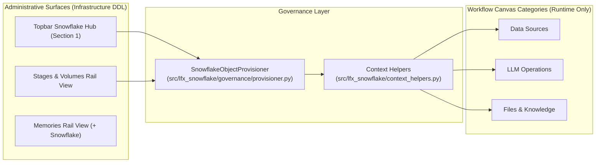

# ADR-005: Governed Snowflake Object Provisioning (`SnowflakeObjectProvisioner`)

- **Status:** Accepted
- **Date:** 2026-10-17

> [!NOTE]
> **Under redesign (W3-R1).** Memory provisioning and the Memories views are being rebuilt to show only real Snowflake objects; External Volumes move to a separate configuration panel. The decisions below describe the target design and are not fully live. Phase 0 changes are on a development branch and not deployed.

## Context
Users configuring SnowflakeLangflow need to provision new Snowflake infrastructure and storage objects directly from the Topbar Snowflake Hub (Section 1), `Stages & Volumes` / `Memories` administration views, and Settings REST APIs without bypassing Snowflake hierarchy, active-role ownership, cost visibility, or governance audit trails, while keeping workflow canvas categories (`Data Sources`, `LLM Operations`, `Files & Knowledge`) focused strictly on runtime workflow execution rather than infrastructure DDL (`W2-R9-03`).

## Decision
Implement `SnowflakeObjectProvisioner` (`src/lfx_snowflake/governance/provisioner.py`) as a dedicated backend governance service invoked from the Topbar Snowflake Hub and administrative modals (and excluded from canvas workflow node categories per `W2-R9-03`), with shared `[ ❄️ Context ]` registration helpers in `src/lfx_snowflake/context_helpers.py`, strict SQL identifier validation (no unescaped string interpolation), hierarchy verification (`Account -> <DATABASE> -> <SCHEMA> -> <OBJECT>`), active-role ownership assignment, mandatory DDL/cost preview (`dry_run=True`), explicit user confirmation (`confirmed=True`), zero silent `OR REPLACE`, and durable audit logging in `<DATABASE>.<SCHEMA>.LANGFLOW_AUDIT_LOG` across all supported object families:

1. **Snowflake Postgres (Account-Level Instance):** `CREATE POSTGRES INSTANCE <POSTGRES_INSTANCE> COMPUTE_FAMILY = ... STORAGE_SIZE_GB = ... AUTHENTICATION_AUTHORITY = ...` (requires `CREATE POSTGRES INSTANCE ON ACCOUNT`; never logs plaintext `access_roles`).
2. **PostgreSQL Internal Objects (`:5432`):** `CREATE EXTENSION IF NOT EXISTS vector` and `CREATE TABLE` inside `<POSTGRES_INSTANCE>` using TLS `verify-ca`.
3. **Database & Schema:** `CREATE DATABASE <DATABASE>` and `CREATE SCHEMA <DATABASE>.<SCHEMA>`.
4. **Snowflake Tables:**
   - `Standard Table` (including `VECTOR(FLOAT|INT, dim)` up to `4096`),
   - `Hybrid Table` (enforcing mandatory `PRIMARY KEY` and rejecting `VECTOR` columns in primary or secondary index keys),
   - `Iceberg Table` (Snowflake-managed storage with `EXTERNAL_VOLUME` and `CATALOG = 'SNOWFLAKE'`),
   - `Interactive Table` (`TARGET_LAG`),
   - `Dynamic Table` (`TARGET_LAG`, `WAREHOUSE`).
5. **Snowflake Stages:** `Internal Named Stage` (`@<DATABASE>.<SCHEMA>.<STAGE_NAME>`) and `External Stage` (bound to an authorized `STORAGE_INTEGRATION`), with backend sub-path traversal validation in both interactive and Tool Mode.

## Governance Separation Schema (`W2-R9-03`)

| Surface | Allowed Operations | Excluded Operations |
|---|---|---|
| **Topbar Snowflake Hub (Section 1)** | Governed DDL (`Database`, `Schema`, `Table`, `View`, `Stage`, `<POSTGRES_INSTANCE>`) | `FUNCTION` (`UDF`/`UDTF`), `PROCEDURE`, `MEMORY` (`HTTP 422 UNSUPPORTED_CAPABILITY`) |
| **Workflow Canvas (`Data Sources`, `LLM Operations`, `Files & Knowledge`)** | Runtime queries, `Custom Tool` (`procedure`/`function`/`table_function`), `Decision`, `AI Redact`, `AI Complete`, `AI Function` | No `Object Provisioner` workflow node (`W2-R9-03`) |

## Consequences
- All object creation from Langflow is governed, auditable, non-destructive, and owned by the active role.

## v0.8.6 Update

Provisioning SQL goes through the shared `sql_safety` helper (identifier validation, typed SQL API bindings, typed `NULL` inlining). Triggers emit valid Snowflake Scripting with `TARGET_COMPLETION_INTERVAL` and run the real flow with the persisted role.

Custom Tool binds boolean and numeric arguments with explicit casts (`?::BOOLEAN`, `?::NUMBER`, `?::FLOAT`), because the SQL API rejects untyped boolean bindings in `CALL` and named arguments of table functions. A stage selected in the flow context is resolved with `SHOW STAGES LIKE` when its metadata is not cached yet.
