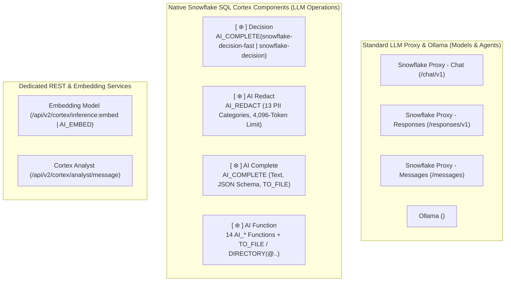

# ADR-006: Consumer Contract for Standard LLM Proxy (3 Protocols), Ollama & Separation of Embeddings, AI Functions, and Cortex Analyst

- **Status:** Accepted
- **Date:** 2026-10-17

## Context
SnowflakeLangflow consumes the Standard LLM Proxy (`universal-v2-20261016` profile) across three distinct wire protocols (`Chat`, `Responses`, `Messages`) plus Snowflake-hosted `Ollama`, while also integrating Snowflake Embeddings, native SQL `AI_*` Functions, and `Cortex Analyst`. Conflating these endpoints causes protocol mismatches, lost reasoning signatures, or incompatible vector spaces.

## Decision
1. **Three Native Proxy Standard Adapters + Ollama:**
   - `Snowflake Proxy - Chat`: base `<LLM_PROXY_BASE_URL>/chat/v1`, inference `/chat/v1/chat/completions`, discovery `/chat/v1/models`, `stream_options.include_usage=True`, multi-round `call_0..call_N` tool ID deduplication, and zero automatic inference retries/fallbacks.
   - `Snowflake Proxy - Responses`: base `<LLM_PROXY_BASE_URL>/responses/v1`, inference `/responses/v1/responses`, discovery `/responses/v1/models`, `response_stream="ordered-items"`, `store=False`, and `include=["reasoning.encrypted_content"]`.
   - `Snowflake Proxy - Messages`: base `<LLM_PROXY_BASE_URL>/messages` (never `/messages/v1` as SDK base), inference `/messages/v1/messages`, discovery `/messages/v1/models`, preserving `thinking.signature` and `redacted_thinking` across multi-tool turns.
   - `Ollama (Snowflake Hosted)`: configurable SPCS endpoint `<OLLAMA_BASE_URL>` separating generative models from verified embedding models.
2. **Strict Separation of Embeddings, Cortex Analyst & AI Functions:**
   - **Embeddings:** The Standard Proxy does not expose `/embeddings`. Use Snowflake's native embedding catalog (`/api/v2/cortex/inference:embed` / `AI_EMBED`) and verified Ollama embedders with a mandatory `(model_id, dimension, space_fingerprint)` compatibility guard.
   - **Cortex Analyst (`[G-A5]`):** Dedicated service (`/api/v2/cortex/analyst/message` over `Semantic View` or validated YAML), not a fourth proxy protocol. Separates SQL generation from role-governed read-only SQL execution, prohibits automatic Semantic View creation or Analyst-on-Postgres, and explicitly passes bounded authorized SQL results across multi-turn conversations.
   - **Native SQL `AI_*` Functions, Dedicated `AI Redact`, `AI Complete` & `Decision` (`[G-A2]`, `W2-R9-02`, `W2-R9-04`):** Executed directly via Snowflake SQL (never the deprecated `SNOWFLAKE.CORTEX.*` namespace) with `EXPLAIN_PRIVILEGES(..., missing_only => true)` and `AI_COUNT_TOKENS`, separated into 4 specialized `LLM Operations` components:
     - `[ ❄️ ] AI Redact` (`SnowflakeAIRedact`): dedicated PII redaction/detection (`redact`, `detect`, `detect_with_allowlist` with reverse-index span splicing) across the 13 official Snowflake PII categories, enforcing the 4,096-token limit via `AI_COUNT_TOKENS('ai_redact', ...)` and `SPLIT_TEXT_RECURSIVE_CHARACTER` auto-chunking with `AI_SQL_ERROR_HANDLING_USE_FAIL_ON_ERROR = FALSE`.
     - `[ ❄️ ] AI Complete` (`SnowflakeAIComplete`): dedicated text, structured JSON schema, and multimodal `TO_FILE('@<DATABASE>.<SCHEMA>.<STAGE_NAME>', '<relative_path>')` inference.
     - `[ ❄️ ] AI Function` (`SnowflakeAIFunction`): exposes the 14 task-specific `AI_*` functions (`AI_CLASSIFY`, `AI_FILTER`, `AI_EXTRACT`, `AI_SENTIMENT`, `AI_SUMMARIZE`, `AI_SUMMARIZE_AGG`, `AI_AGG`, `AI_TRANSLATE`, `AI_SIMILARITY`, `AI_TRANSCRIBE`, `AI_PARSE_DOCUMENT`, `AI_EMBED`, `AI_MULTI_EMBED`, `AI_COUNT_TOKENS`) with full Internal Stage (`SNOWFLAKE_SSE`/`SNOWFLAKE_FULL`) & External Bucket (`S3`, `GCS`, `Azure`, `S3-Compatible`) `TO_FILE(...)` and `DIRECTORY(@<DATABASE>.<SCHEMA>.<STAGE_NAME>)` multimodal support.
     - `[ ❄️ ] Decision` (`SnowflakeDecision`): executes official `AI_COMPLETE` decision models (`snowflake-decision-fast` default and `snowflake-decision`) with `TO_JSON({'state': ..., 'questions': ...})` across `choice`, `score` (`0..n-1`), and `noul` question types (`1..32` questions, max `256` total options) without passing `model_parameters`, `response_format`, `streaming`, `guardrails`, `temperature`, or `top_p`.

## Multi-Protocol & Cortex SQL Separation Schema (`W2-R9-02`, `W2-R9-04`)

| Component / Adapter | Execution Endpoint / SQL Function | Multimodal & Stage Support |
|---|---|---|
| **`Snowflake Proxy - Chat / Responses / Messages`** | `<LLM_PROXY_BASE_URL>/chat/v1`, `/responses/v1`, `/messages` | Wire-protocol multimodal content blocks |
| **`[ ❄️ ] Decision`** | `AI_COMPLETE(model => '<snowflake-decision-fast\|snowflake-decision>', prompt => TO_JSON({'state': ..., 'questions': ...}), return_error_details => TRUE)` | Single State & Table-Level (`choice`, `score` `0..n-1`, `noul`) |
| **`[ ❄️ ] AI Redact`** | `AI_REDACT(input => ..., categories => [...], mode => 'redact'\|'detect')` | Text, Table Column, Stage Document (`AI_PARSE_DOCUMENT`), Stage Audio/Video (`AI_TRANSCRIBE`) |
| **`[ ❄️ ] AI Complete`** | `AI_COMPLETE` | Text, JSON Schema, and `TO_FILE('@<DATABASE>.<SCHEMA>.<STAGE_NAME>', '<path>')` (`Image`, `Audio/.mp3`, `Video`, `Document`) |
| **`[ ❄️ ] AI Function`** | 14 task-specific `AI_*` functions (`AI_CLASSIFY` .. `AI_COUNT_TOKENS`) | `TO_FILE('@<DATABASE>.<SCHEMA>.<STAGE_NAME>', '<path>')` and `DIRECTORY(@<DATABASE>.<SCHEMA>.<STAGE_NAME>)` |

## Consequences
- Full multi-turn tool and reasoning fidelity across all 3 proxy protocols, safe vector space isolation, and zero unapproved proxy mutations.
