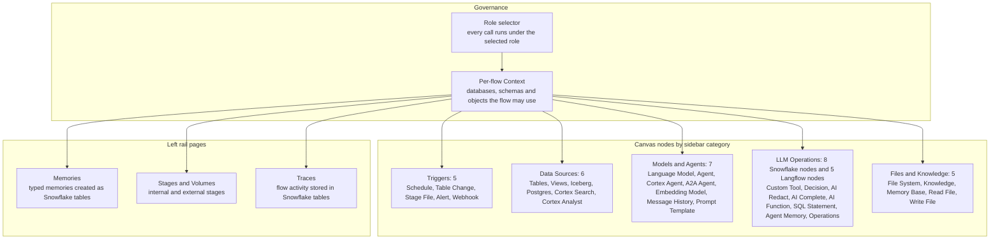

# Native Snowflake Langflow — Capability & Component Matrix

**Tested Cloud Environment: AWS — Snowflake on AWS**  
**Upstream Baseline:** official image `langflowai/langflow:1.13.1@sha256:643d78228cd148be70e52a860dd3456c834a070c98c81b354f713908d40949f8` (MIT License; extension code only, no upstream source in this repository)

---

> [!NOTE]
> Status values: **Live** (deployed and verified), **In progress** (the node exists but is not fully verified end to end), **Planned** (not implemented). For a plain-language overview start from the [README](../README.md).

## Executive Summary & Visual Capability Map

### Complete Component Inventory by Category

| Sidebar Category | Component Display Name | Class Name | Primary Role in Workflows | Status |
|---|---|---|---|---|
| **Triggers** | `[ ❄️ ] Schedule Trigger` | `SnowflakeScheduleTrigger` | Cron (`USING CRON`) or interval (`Minutes`..`Months`) Snowflake Task trigger | Live |
| **Triggers** | `[ ❄️ ] Table Change Trigger` | `SnowflakeTableChangeTrigger` | CDC row-change trigger via `STREAM ON TABLE/VIEW` + Triggered Task | Live |
| **Triggers** | `[ ❄️ ] Stage File Trigger` | `SnowflakeStageFileTrigger` | File-arrival trigger on `@<DATABASE>.<SCHEMA>.<STAGE_NAME>` directory table | Live |
| **Triggers** | `[ ❄️ ] Condition Alert Trigger` | `SnowflakeAlertTrigger` | Read-only SQL threshold/anomaly trigger via `SNOWFLAKE ALERT` | Live |
| **Triggers** | `Webhook` | `WebhookComponent` | External HTTP POST trigger (`WEBHOOK_RUN`) | Live |
| **Data Sources** | `[ ❄️ ] Tables` | `SnowflakeTablesComponent` | Reads `Standard`, `Hybrid`, `Dynamic`, and `Interactive` tables in `[ ❄️ Context ]` | Live |
| **Data Sources** | `[ ❄️ ] Views` | `SnowflakeViewsComponent` | Reads `Standard`, `Secure`, and `Materialized` views in `[ ❄️ Context ]` | Live |
| **Data Sources** | `[ ❄️ ] Iceberg Tables` | `SnowflakeIcebergTablesComponent` | Reads Apache Iceberg tables managed in Snowflake | Live |
| **Data Sources** | `[ ❄️ ] Postgres` | `SnowflakePostgresComponent` | Account-level connection to `<POSTGRES_INSTANCE>` (`:5432`) | Live |
| **Data Sources** | `[ ❄️ ] Cortex Search` | `SnowflakeCortexSearchComponent` | Queries Cortex Search services (also usable as Agent `StructuredTool`) | Live |
| **Data Sources** | `[ ❄️ ] Cortex Analyst` | `SnowflakeCortexAnalystComponent` | Natural-language-to-SQL over Semantic Views or `@Stage` YAML models | Live |
| **Models & Agents** | `Language Model` | `LanguageModelComponent` | Direct LLM calls with 4 Snowflake providers (`Chat`, `Responses`, `Messages`, `Ollama`) | Live |
| **Models & Agents** | `Agent` | `AgentComponent` | Tool-calling Agent with dynamic `Reasoning Effort` & `Extended Thinking` | Live |
| **Models & Agents** | `[ ❄️ ] Cortex Agent` | `SnowflakeCortexAgentComponent` | Invokes Snowflake Cortex Agents with 2-level `Threads API` continuity | Live |
| **Models & Agents** | `A2A Agent` | `SnowflakeA2AAgentComponent` | Internal (`[Langflow Flow]` / `[Cortex Agent]`) and External A2A v0.3.0 bridge | Live |
| **Models & Agents** | `Embedding Model` | `EmbeddingModelComponent` | Includes `Snowflake Cortex` (`AI_EMBED` 6 models: `768d` & `1024d`) | Live |
| **Models & Agents** | `[ ❄️ ] Message History` | `SnowflakeMessageHistoryComponent` | Stores and reads chat turns in the governed Snowflake table set in `LANGFLOW_MESSAGES_TABLE`, scoped to the active role | Live |
| **Models & Agents** | `Prompt Template` | `PromptComponent` | Native Langflow prompt templating | Live |
| **LLM Operations** | **`[ ❄️ ] Custom Tool`** | `SnowflakeCustomTool` | Snowsight-aligned custom tool (`procedure`, `function`, `table_function`) with `DESCRIBE` auto-discovery, manual parameter editor (blocking `OBJECT`), and `tool_spec` + SQL execution | Live |
| **LLM Operations** | **`[ ❄️ ] Decision`** | `SnowflakeDecision` | Official `AI_COMPLETE` decision models (`snowflake-decision-fast` & `snowflake-decision`) supporting `choice`, `score` (`0..n-1`), and `noul` (`1..32` questions, max `256` options) + confidence routing | Live |
| **LLM Operations** | **`[ ❄️ ] AI Redact`** | `SnowflakeAIRedact` | Dedicated PII masking & detection (`redact`, `detect`, `detect_with_allowlist`) across the 13 official Snowflake PII categories with 4,096-token auto-chunking | Live |
| **LLM Operations** | **`[ ❄️ ] AI Complete`** | `SnowflakeAIComplete` | Text, JSON schema, and Internal/External Stage multimodal (`TO_FILE` / `DIRECTORY`) completion (`Images`, `.mp3/Audio`, `Video`, `Documents`) | Live |
| **LLM Operations** | **`[ ❄️ ] AI Function`** | `SnowflakeAIFunction` | 14 task-specific `AI_*` functions (`AI_CLASSIFY`, `AI_FILTER`, `AI_EXTRACT`, `AI_SENTIMENT`, `AI_SUMMARIZE`, `AI_SUMMARIZE_AGG`, `AI_AGG`, `AI_TRANSLATE`, `AI_SIMILARITY`, `AI_TRANSCRIBE`, `AI_PARSE_DOCUMENT`, `AI_EMBED`, `AI_MULTI_EMBED`, `AI_COUNT_TOKENS`) with Internal & External Stage multimodal support | Live |
| **LLM Operations** | **`[ ❄️ ] SQL Statement`** | `SnowflakeSQLStatement` | Governed parameterized SQL statement execution under `CURRENT_ROLE()` | Live |
| **LLM Operations** | **`[ ❄️ ] Agent Memory`** | `SnowflakeAgentMemory` | Save, recall and clean up a typed Snowflake memory (checkpointer, summary, profile, episodic); in Tool Mode exposes `save_*` and `recall_*` tools to an agent | Live |
| **LLM Operations** | **`[ ❄️ ] Operations`** | `SnowflakeLLMNode` | Multi-operation Snowflake Cortex helper node | Live |
| **Files & Knowledge** | `File System` | `FileSystemTool` | Stage file browsing and governed Internal/External stage management | In progress |
| **Files & Knowledge** | `Knowledge` | `KnowledgeComponent` | Vector knowledge base over Snowflake `VECTOR` tables, Cortex Search, or `pgvector` | In progress |
| **Files & Knowledge** | `Memory Base` | `MemoryBaseComponent` | Memory fed from chat turns with optional LLM preprocessing; stored in governed `LF_MEM_*` tables | Live |
| **Files & Knowledge** | `Read File` | `FileComponent` | Stage file reader integrated with `AI_PARSE_DOCUMENT` (`LAYOUT` / `OCR`) | In progress |
| **Files & Knowledge** | `Write File` | `SaveToFileComponent` | Safe atomic write/append to `@<DATABASE>.<SCHEMA>.<STAGE_NAME>` | In progress |

---

## 1. Qualification Matrix (`Q1..Q4`)

| Qualification ID | Area | Architectural Resolution & Enforcement Contract |
|---|---|---|
| **Q1** | Real Active Role Switching under SPCS | Discovers roles via `SELECT CURRENT_AVAILABLE_ROLES()`. Maintains role-segregated session pool `(user_principal, active_role)` verified via `SELECT CURRENT_ROLE()`. Increments `context_epoch` and invalidates all caches on switch/revocation. Prohibits `SECONDARY ROLES ALL` and silent fallback to service owner. |
| **Q2** | `Python Interpreter` + Snowflake Artifact Repository PyPI | Integrates with `snowflake.snowpark.pypi_shared_repository` requiring database role `SNOWFLAKE.PYPI_REPOSITORY_USER`. Executes in an isolated environment with declared package versions and zero silent fallback to public PyPI or ambient credentials. |
| **Q3** | `ToolGuard / Policies` (ALTK Beta) | Extends the `Language Model` selector in ALTK `Policies` with `Snowflake Proxy - Responses`, `Snowflake Proxy - Messages`, `Snowflake Proxy - Chat`, and `Ollama (Snowflake Hosted)` for both `Generate` and `Guard` modes. Enforces fail-closed execution when `Enabled = true`. Leaves all other `Discover more components` bundles unchanged (`[G-A6]`). |
| **Q4** | `A2A` Client & Server + `Cortex Agent Run API` | Client supports internal Langflow A2A endpoints and `Cortex Agent Run API` (`/api/v2/databases/<DATABASE>/schemas/<SCHEMA>/agents/<AGENT>:run` and `/api/v2/cortex/agent:run`) preserving `thread_id` and `parent_message_id` (from last successful assistant `message_id`). Server requires `Chat Input` + `Chat Output`, separates `Save` vs `Publish`, authenticates caller on SPCS without inheriting flow owner privileges, and guards against recursive loops. |

---

## 2. Requirements & Refinements Matrix (`REQ-01..REQ-17`)

| ID | Requirement | Module / Component | Verification Gate |
|---|---|---|---|
| **REQ-01** | Preserved Langflow UI & Official Snowflake Branding | `frontend_patches/`, `lfx_snowflake/bundle_manifest.py` | Official black Snowflake logo in topbar (home + flow), GitHub/Discord/X removed, `Snowflake Documentation` (`https://docs.snowflake.com/`) with color logo in profile menu (`[G-A6]`). |
| **REQ-02** | Real Role Selector & Explicit Denials Everywhere | `lfx_snowflake/governance/` | 4-code taxonomy (`AUTHZ_ROLE_DENIED` HTTP 403 *"Il ruolo attivo (`<ROLE>`) non consente questa operazione"*, `OBJECT_NOT_FOUND_OR_UNAUTHORIZED`, `UNSUPPORTED_CAPABILITY`, `TECHNICAL_EXECUTION_ERROR`), `EXPLAIN_PRIVILEGES(..., missing_only => true)`. |
| **REQ-03** | Flow Import under `New Flow` | `frontend_patches/`, `lfx_snowflake/components/files_knowledge.py` | `Upload from computer` (secret redaction, no code execution), `Add from stage` (`@<DATABASE>.<SCHEMA>.<STAGE_NAME>`), `Add from Git` (commit provenance). |
| **REQ-04** | Extended `Settings` (`Model Providers`, `DB Providers`, `Messages`, `Global Variables`) | `frontend_patches/`, `lfx_snowflake/providers/registry.py` | 3 Proxy protocols + Ollama, 4 vector backends, multi-protocol message edit/delete with signature invalidation, read-only `SNOWFLAKE_ACTIVE_ROLE`. |
| **REQ-05** | Structured `Data Sources` + `Cortex Analyst` in Unified Session (`[G-A5]`) | `lfx_snowflake/components/data_sources.py` | Separates visibility, `SELECT`, and semantic readiness (`Semantic View` / YAML). No auto Semantic View creation, no Analyst-on-Postgres, no cross-engine implicit joins, bounded SQL results across turns. |
| **REQ-06** | 3 Native Proxy Standard Protocols + `Ollama` | `lfx_snowflake/providers/registry.py` | `/chat/v1`, `/responses/v1` (`ordered-items`, `store=False`, `include=["reasoning.encrypted_content"]`), `/messages` (inference `/messages/v1/messages`, `thinking.signature`, `redacted_thinking`), `<OLLAMA_BASE_URL>`, `call_0..call_N` deduplication, 0 silent retries. |
| **REQ-07** | Snowflake `Embedding Model` | `lfx_snowflake/providers/registry.py` | Separate catalog (`/api/v2/cortex/inference:embed` / `AI_EMBED` + verified Ollama embedders) with `(model_id, dimension, space_fingerprint)` guard. |
| **REQ-08** | `Message History` on a governed Snowflake table (`LANGFLOW_MESSAGES_TABLE`) | `lfx_snowflake/components/utilities_a2a.py` | Store/Retrieve (`Messages`/`Table`), separating visible UI messages, signed protocol replay state, and Cortex Agent thread references. |
| **REQ-09** | `LLM Operations` + `Custom Tool`, `Decision`, `AI Redact` & `AI Function` (`[G-A2]`, `W2-R9-01..04`) | `lfx_snowflake/components/llm_operations.py`, `lfx_snowflake/components/ai_function.py`, `native_category_components/llm_operations/` | `Batch Run`, `Guardrails`, `Smart Router`, `Smart Transform`, `Structured Output` (`LLM Selector` unchanged) + `[ ❄️ ] Custom Tool` (`procedure`/`function`/`table_function`), `[ ❄️ ] Decision` (`snowflake-decision-fast` / `snowflake-decision`), `[ ❄️ ] AI Redact` (13 official PII categories, 4,096-token limit + auto-chunking), `[ ❄️ ] AI Complete`, and `[ ❄️ ] AI Function` (14 `AI_*` functions with Internal Stage `@<DATABASE>.<SCHEMA>.<STAGE_NAME>` & External Bucket multimodal `TO_FILE` / `DIRECTORY`). |
| **REQ-10** | `Files & Knowledge` & `Memories / Create Memory` (`[G-A3]`, `[G-A4]`) (real Snowflake objects only; browser upload to stages is not available) | `lfx_snowflake/components/files_knowledge.py` | `File System` (stage creation), `Read File`, `Write File` (safe atomic `Append`, internal vs external stages), `Knowledge` & `Create Memory` (optional `LLM Preprocessing`, separated `CREATE` vs use permissions, cross-session isolation) across 4 vector backends. |
| **REQ-11** | Unchanged Core Categories | `lfx_snowflake/bundle_manifest.py`, `frontend_patches/` | `Input & Output`, `Prompt Template`, `Processing`, `Flow Control` (with `[Beta]` badges on `Listen`, `Notify`, `Run Flow`), `LLM Selector`, `Calculator`, `Current Date` 100% unchanged. |
| **REQ-12** | `Utilities`: `Python Interpreter` with Snowflake PyPI | `lfx_snowflake/components/utilities_a2a.py` | Uses `snowflake.snowpark.pypi_shared_repository` (`SNOWFLAKE.PYPI_REPOSITORY_USER`) with zero fallback to public PyPI. |
| **REQ-13** | `ToolGuard / Policies` (ALTK Beta, `[G-A6]`) | `lfx_snowflake/components/utilities_a2a.py` | 3 Proxy protocols + Ollama in `Policies`, fail-closed on error, other `Discover more components` bundles untouched. |
| **REQ-14** | `A2A` End-to-End (`A2A Agent` + `Cortex Agent` & `Serve as an A2A agent`) | `lfx_snowflake/components/utilities_a2a.py` | Client + Server A2A + Cortex Agent Threads adapter, caller RBAC enforcement, recursion guard. |
| **REQ-15** | `Flow Activity` SQL Trace Replication & Audit Outbox (`[G-A1]`) | `lfx_snowflake/observability/` | Canonical tables `<DATABASE>.<SCHEMA>.LANGFLOW_FLOW_RUNS`, `<DATABASE>.<SCHEMA>.LANGFLOW_FLOW_SPANS`, `<DATABASE>.<SCHEMA>.LANGFLOW_AUDIT_LOG`, idempotent `MERGE INTO`, pre-sink redaction, no side-effect re-execution on retry, UI soft-delete (`deleted_in_ui_at`) with anti-resurrection filter. |
| **REQ-16** | Governed Snowflake Object Provisioning | `lfx_snowflake/governance/` | Provisioning with DDL preview, cost/impact notice, explicit confirmation, active-role ownership, and audit logging for `<POSTGRES_INSTANCE>`, `pgvector`, Databases, Schemas, `Standard`/`Hybrid`/`Iceberg`/`Interactive`/`Dynamic` Tables, and Stages. |
| **REQ-17** | 100% Account-Agnostic Public Repo + AWS Attestation | `scripts/verify_public_repo_sanitization.py` | Automated pre-commit/CI scanner verifying zero secrets, zero denylist matches, parametric placeholders, and explicit AWS test attestation. |

---

## 3. Wave 2 UI, Hub & Sidebar Enhancement Matrix

| Enhancement ID | Area | Implementation & Verification Contract |
|---|---|---|
| **UI-W2-01** & **W2-R3-01..02** | Browser Tab Branding, `#29B5E8` `Loading...` Screen & `+ Create first flow` CTA | `<title>Snowflake Langflow</title>` + Snowflake SVG favicon in `index.html`, read-only `MutationObserver` (`ensureDualSymbolLoadingOverlay()`), and `#29B5E8` styling on `Loading...` and `+ Create first flow` (`[data-testid="new-project-btn"]`). |
| **HUB-W2-01** & **HUB-W2-FIX-FETCH** | Topbar Alignment & JSON Content-Type | Right-aligned `Role: <select>` and `[ ❄️ Context ]` button via `alignTopbarControls()`; explicit `Content-Type: application/json` header on `POST /api/v1/snowflake/traces/sync`. |
| **HUB-W2-02** & **W2-R3-03..04** | Per-Flow `[ ❄️ Context ]` — Snowsight Hierarchical Tree & Fluid Responsive CSS | Snowsight Database Explorer hierarchical tree (`data-testid="snowsight-hierarchy-tree"`, `data-testid="snowsight-hierarchy-search"`, tri-state cascading checkboxes with `data-indeterminate`), lazy-loaded `/api/v1/snowflake/schemas` and `/api/v1/snowflake/objects`, and fluid `clamp(320px, 94vw, 980px)` / `min(90dvh, 90vh)` layout. |
| **HUB-W2-03** & **HUB-W2-04** | Hierarchical Provisioning & Routine Exclusion | Enforces `1. Database -> 2. Schema -> 3. Object` with active-role grey-out warnings (`role_privileges`). Strictly rejects `FUNCTION`/`PROCEDURE`/`MEMORY` creation from Object Provisioner (`HTTP 422 UNSUPPORTED_CAPABILITY`). |
| **HUB-W2-05** & **W2-R3-05..06** | Memories (`+ ❄️ Snowflake`) — typed memories as Snowflake tables | The `+ ❄️ Snowflake` button is shown only on `Memories` and opens the `Create a Snowflake Memory` wizard (`data-testid="create-snowflake-memory-modal"`). Four types are created as real `MEM_<NAME>` tables (Standard or Hybrid) in the flow context: `graph_state_checkpointer`, `summary_memory`, `user_profile_entity_memory`, `episodic_memory` (optional `AI_EMBED` similarity). `buffer_window_memory` is refused and points to `Message History`; other backends and non-Cortex embeddings are refused with `422 UNSUPPORTED_CAPABILITY`. |
| **W2-R3-07** | SPCS Runtime Stability (SQLite WAL & Writable `UV_CACHE_DIR`) | Configures `PRAGMA journal_mode=WAL; PRAGMA synchronous=NORMAL; PRAGMA busy_timeout=30000; PRAGMA temp_store=MEMORY;` on `/persist/langflow.db` and SQLAlchemy connections, and sets writable `UV_CACHE_DIR=/tmp/uv-cache`. |
| **DS-W2-01** & **W2-R9-03** | `Data Sources` Hierarchy & `Object Provisioner` Removal from Workflows | `SnowflakeDataSourceComponent` ordered `Engine -> Database -> Schema -> Object Type -> Table / View Name`. `Object Provisioner` removed from workflow node categories (`Data Sources`, `LLM Operations`, `Files & Knowledge`) and retained exclusively as the backend wizard service (`src/lfx_snowflake/governance/provisioner.py`), with shared helpers in `src/lfx_snowflake/context_helpers.py`. |
| **MA-W2-01** | `Models & Agents` Cascading Cortex Agent | `SnowflakeCortexAgentComponent` cascades `Database -> Schema -> Cortex Agent` (`SHOW AGENTS IN SCHEMA`). |
| **W2-R9-01..04** | `LLM Operations` Refactoring (`Custom Tool`, `Decision`, `AI Redact`, `AI Complete`, `AI Function`, `SQL Statement`, `Operations`) | Replaces `Stored Procedure` and `Function (UDF / UDTF)` with Snowsight-aligned `Custom Tool` (`snowflake_custom_tool.py`); redesigns `Decision` (`snowflake_decision.py`) on `snowflake-decision-fast` (default) and `snowflake-decision` (`choice`, `score` `0..n-1`, `noul`); separates `AI Redact` (`snowflake_ai_redact.py`, 13 PII categories, 4,096-token limit + auto-chunking) from `AI Function` (`snowflake_ai_function.py`, 14 `AI_*` functions) and `AI Complete` (`snowflake_ai_complete.py`), with full Internal & External Stage (`@<DATABASE>.<SCHEMA>.<STAGE_NAME>`) multimodal `TO_FILE(...)` and `DIRECTORY(@...)` support. |
| **TRG-W2-R8-01..07** | `Triggers` (`triggers`, `icon="Zap"`) Sidebar Category & SPCS Service Function (`RUN_LANGFLOW_FLOW`) | Positioned immediately after `Input & Output` and before `Data Sources`. Provides `Schedule Trigger`, `Table Change Trigger`, `Stage File Trigger`, `Condition Alert Trigger`, and `Webhook`, executed via `<DATABASE>.<SCHEMA>.RUN_LANGFLOW_FLOW` (`POST /api/v1/snowflake/service-trigger`) under `CURRENT_ROLE()`. |
| **W2-R9-05** & **W2-R9-06** | Transient Overlay Auto-Dismiss (`dismissTransientSnowflakeOverlays`) & Clean Startup Persistence | Automatically closes `#sflf-memory-type-dropdown` and transient overlays on left-rail tab switch, leaving `Memories`, outside click, `Escape`, or route change (`W2-R9-05`). Disables unsolicited auto-seeding of `Snowflake_Full_Memory_Enterprise_Agent` unless `SNOWFLAKE_SEED_SHOWCASE_FLOW=true` and purges unsolicited `New Flow (Backup)` rows while preserving 100% of user flows in `/persist/langflow.db` (`W2-R9-06`). |

---

## 4. v0.8.6 Capability Updates

| Area | Capability | Behaviour |
|---|---|---|
| Perimeter | Langflow-native auth on `/api/v1/snowflake/*` | API key or browser session required; only the A2A agent card may be public. |
| RBAC | `USE SECONDARY ROLES NONE` | Applied to every session; fail closed on error. |
| RBAC | Privileged roles | Selectable only with a verified grant. |
| RBAC | Role sessions | Per user and per flow; caller's-rights role takes precedence in caller mode. |
| SQL safety | Shared `sql_safety` helper | Typed SQL API bindings, typed `NULL` inlining, identifier validation. |
| Context | Flow `[ ❄️ Context ]` guard | Fail closed for all component SQL. |
| Runtime | Stale component code guard | `upgrade` (default) or `refuse` with `COMPONENT_CODE_OUTDATED`. |
| Files & Knowledge | Split Text UDF | Bridge-owned; provisioned by `scripts/provision_bridge_routines.py`. |
| Triggers | Scheduling & execution | Valid Snowflake Scripting, `TARGET_COMPLETION_INTERVAL`, cron steps, real flow run with persisted role. |
| LLM Operations | Custom Tool / Decision / AI Redact / tokens / SQL Statement | Typed args; routing; detect mode; `AI_COUNT_TOKENS`; row limits and bindings. |
| Models & Agents | Cortex Agent | Thread continuity; clean `Message` output. |
| Models & Agents | A2A | Call-chain limits; JSON-RPC `-32000` authz, `-32001` task not found, `-32002` not cancelable. |
| Memories | `LF_MEM_*`, Message History | Governed objects, single `AI_EMBED` catalog, kill phrase. |
| Tools | MCP Tools | Direct streamable project server; `localhost,127.0.0.1` in `LANGFLOW_SSRF_ALLOWED_HOSTS`. |
| Models & Agents | Snowflake Proxy | `Messages` / `Responses` / `Chat` replay per session. |
| Observability | Run/trace telemetry | One RUN per execution; batched span sync on run close. |
| LLM Operations | `AI Function` Tool Mode | One structured tool per function (`snowflake_<function>`), typed `input_text` argument. |
| LLM Operations | AI text outputs | `AI Complete`, `AI Function`, `AI Redact` return plain text; empty completions raise an explicit error. |
| LLM Operations | Custom Tool bindings | Booleans and numbers bound with explicit casts; routine failures fail the tool call. |
| Data Sources | Tool Mode | `Tables`, `Views`, `Iceberg Tables`, `Postgres` return structured tools with a typed input schema. |
| Models & Agents | A2A internal targets | Only flows served as A2A agents in the caller's project are offered. |
| Memories | Preset preprocessing | Preset instructions are stored and used by the preprocessing step; neutral default without a preset. |
| Context | Attached Memory Base | Its `LF_MEM_*` table stays in the flow `[ ❄️ Context ]` across context saves. |
| Stages & Volumes | Stage listing | A selected stage's type is resolved on demand, so it is listed right after a context save. |
| Observability | Unlinked spans | Attributed to a derived run id; span batches are never rejected for a missing run id. |
| LLM Operations | SQL Statement `Bind Values` port | Upstream node values are bound to the `?` placeholders after the static bind parameters; never inlined in the SQL text. |
| LLM Operations | SQL Statement execution | The statement runs once per run even when several output ports are connected (a `CALL` or DML is not repeated). |
| Memories | Memory location | A `DB.SCHEMA` value of `LANGFLOW_MEMORY_SCHEMA` names the memory database, so a flow whose context starts with another database can have Memory Bases. |
| Memories | Duplicate name | Refused with `MEMORY_BASE_NAME_TAKEN` (409) before any table is created. |
| Memories | Typed memories (`+ ❄️ Snowflake`) | One Standard or Hybrid table `MEM_<NAME>` in the flow context; configuration stored in the table comment and read back from Snowflake, so memories are listed after a restart. Delete drops the table and its task. |
| Memories | Capture instruction and cleanup | The instruction written at creation becomes the description of the agent's save tool. Retention (age, row cap by outcome score, checkpoint lifetime) is enforced by a Snowflake task and can be run on demand. |
| Memories | Unsupported backends | Snowflake Postgres, Dynamic, Interactive, Iceberg, Cortex Search, chat-window memories and non-Cortex embeddings are refused (422) instead of registered. A Hybrid table that cannot be created is an error. |
| Memories | Episodic scope | Episodes saved under a node `Key` are recalled only for that key; without a key an episodic memory is shared by all sessions. |
| Memories | Memories page | The `+ ❄️ Snowflake` menu lists only what is created (chat-window type points to `Message History`), reopens after the wizard is closed, the wizard closes after a successful create, and the detail view lists the rows read from the memory table. |
| Models & Agents | Message History outputs | `Chat History` returns a plain transcript for prompts, `Stored Message` the stored text; the full record is on `Table Records`. A `Store` node writes once per run whatever the number of outputs evaluated. |
| Models & Agents | Message History conversations | `Conversation Name` gives a node its own window inside the session, so parallel branches of one flow do not read each other's messages. |
| LLM Operations | Decision `Summary (text)` output | One readable line per question instead of the full decision object. |
| Stages & Volumes | Creation outcome | A failed `CREATE STAGE` / `CREATE EXTERNAL VOLUME` returns the Snowflake error and registers nothing; URL, integration or role ARN are required, never defaulted. |
| Memories | Default gate model | `claude-haiku-5-5` when the request names no preprocessing model; pass `preproc_model` to choose another one. |
| Memories | Delete | Evaluated under the role of the flow that owns the Memory Base. |
| Showcases | Four reference flows | Multi Cortex Agent chain, Agent with all Snowflake tools (also over MCP), Language Model + Decision routing, A2A forms. |
