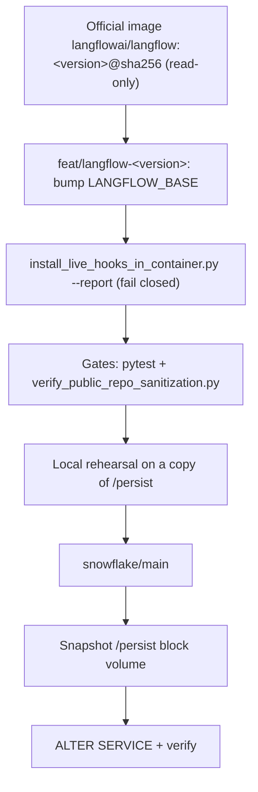

# Upstream Synchronization & Fork Maintenance Guide (`ADR-001`)

> **Disclaimer & Ownership:** This repository is a personal, independent fork developed by **Francesco Battaglieri** ([@fbattaglieri-snowflake](https://github.com/fbattaglieri-snowflake)) of the upstream open-source project [langflow-ai/langflow](https://github.com/langflow-ai/langflow) (MIT License). **It is NOT an official project or product of Snowflake Inc. nor of Langflow / DataStax**, and it is **currently under active testing and validation (Work in Progress / Experimental Testing)**.

**Upstream:** `https://github.com/langflow-ai/langflow` and the official `langflowai/langflow` images (read-only)  
**Current Base Image:** `langflowai/langflow:1.13.1@sha256:643d78228cd148be70e52a860dd3456c834a070c98c81b354f713908d40949f8`  
**Protected Primary Branch:** `snowflake/main`

## Sync Model: Pinned Base-Image Bump (not a git merge)

This repository contains only the Snowflake extension code (`src/lfx_snowflake/`, `frontend_patches/`, `scripts/`, `sql/`, `docs/`). It does **not** contain the upstream Langflow source, so there is nothing to merge. `Dockerfile.release` starts from the official image named in `LANGFLOW_BASE` and runs the installer once against its site-packages. Upgrading Langflow means changing that one pinned reference and proving that the installer, the tests, and the database migration still work.

---

## 0. Mandatory Upstream Update Rules (`RULE-SYNC-01` .. `RULE-SYNC-07`)

| Rule ID | Rule Name | Enforcement |
|---|---|---|
| `RULE-SYNC-01` | **Read-Only Upstream** | Upstream repository and images are consumed read-only. Push branches and tags only to `origin`. |
| `RULE-SYNC-02` | **Stable Release Pinning** | Use only published releases (no `rc`, no untagged `main`), pinned as `langflowai/langflow:<version>@sha256:<DIGEST>`. |
| `RULE-SYNC-03` | **Dedicated Upgrade Branch** | Stage each bump on `feat/langflow-<version>`; merge into `snowflake/main` only after all gates below pass. |
| `RULE-SYNC-04` | **Bundle Isolation & 6 Hook Points** | Keep Snowflake code inside `src/lfx_snowflake/` and the 6 tracked hooks. `install_live_hooks_in_container.py --report` must show every hook matched exactly as expected; invariant categories stay untouched. |
| `RULE-SYNC-05` | **Blocking Sanitization Gate** | `python3 scripts/verify_public_repo_sanitization.py` must report 0 secrets and 0 denylist matches before commit. |
| `RULE-SYNC-06` | **Full Test & Protocol Qualification** | `pytest` must pass 100% across all governance, observability, 3 Proxy protocols (`Chat`, `Responses`, `Messages`), Ollama, and component tests. |
| `RULE-SYNC-07` | **Snapshot Before Migration & Rollback** | Upstream migrations are irreversible. Snapshot the `/persist` block volume (and back up `<POSTGRES_INSTANCE>` if used) before `ALTER SERVICE`. Rollback = previous image + snapshot restore. |

---

## 1. Branching Strategy

| Branch Pattern | Purpose |
|---|---|
| `snowflake/main` | Protected main branch containing verified SnowflakeLangflow releases |
| `feat/<area>` | Scoped feature branches (e.g., `feat/governance-r0`, `feat/proxy-adapters-r1`) |
| `feat/langflow-<version>` | Base-image bump for a new upstream release (e.g., `feat/langflow-1.13.1`) |

The former `sync/upstream-<version>` merge branches are obsolete because the repository no longer carries upstream history.

---

## 2. Strict Isolation: `lfx_snowflake` Bundle vs Tracked Core Patches

To keep base-image upgrades mechanical, 95%+ of Snowflake-specific logic resides inside the self-contained package `src/lfx_snowflake/`:

- `src/lfx_snowflake/governance/` — `SnowflakeAuthzService`, `SnowflakeObjectProvisioner`, role-bound session pool, 4-code error taxonomy, and `EXPLAIN_PRIVILEGES` pre-checks.
- `src/lfx_snowflake/observability/` — `SnowflakeTraceReplicator` (`<DATABASE>.<SCHEMA>.LANGFLOW_FLOW_RUNS`, `<DATABASE>.<SCHEMA>.LANGFLOW_FLOW_SPANS`), `SnowflakeAuditOutbox` (`<DATABASE>.<SCHEMA>.LANGFLOW_AUDIT_LOG`), deterministic pre-sink secret/PII redactor.
- `src/lfx_snowflake/providers/` — Native adapters for `Snowflake Proxy - Chat`, `Snowflake Proxy - Responses`, `Snowflake Proxy - Messages`, `Ollama (Snowflake Hosted)`, and Snowflake `Embedding Model`.
- `src/lfx_snowflake/context_helpers.py` — Shared per-flow context resolution (`_resolve_flow_id`), DDL verification (`_ddl_succeeded`), and `[ ❄️ Context ]` object registration helpers (`_register_created_object`, `_can_create_database`, `_can_create_schema`).
- `src/lfx_snowflake/components/` — `Data Sources` + `Cortex Analyst`, `LLM Operations` + `Custom Tool` (`procedure`/`function`/`table_function`) / `Decision` (`snowflake-decision-fast` & `snowflake-decision`) / `AI Redact` (13 PII categories, 4,096-token limit + auto-chunking) / `AI Complete` / `AI Function` (14 `AI_*` functions + Internal & External Stage multimodal `TO_FILE` / `DIRECTORY`) / `SQL Statement`, `Files & Knowledge` + `Create Memory` + 4-stage `Cortex Search` indexing pipeline (`AI_PARSE_DOCUMENT`, `SPLIT_TEXT_RECURSIVE_CHARACTER`, `CREATE CORTEX SEARCH SERVICE`, `Stream + Task`), `Message History`, `Python Interpreter` (Snowflake PyPI), `ToolGuard / Policies` (ALTK), and `A2A Agent` / `Cortex Agent`.
- `src/lfx_snowflake/native_category_components/` & `scripts/install_live_hooks_in_container.py` — Native Langflow sidebar component classes (`1 class = 1 file`) and build-time `component_index.json` / `index.html` / `snowflake-ui-integration.js` installer (`UI-W2-01`, `HUB-W2-01..05`, `W2-R3-01..07`, `DS-W2-01`, `PROV-W2-01`, `MA-W2-01`, `LLM-W2-01..06`, `FK-W2-01..04`, `TRG-W2-R8-01..07`, `W2-R9-01..06`, including Snowsight hierarchical tree selector, 5 LangChain/Langflow Memory Types with optional embeddings, transient overlay auto-dismiss `dismissTransientSnowflakeOverlays`, clean startup flow persistence, and SPCS SQLite WAL / `UV_CACHE_DIR` runtime hardening).

### Tracked Core Patch Registry (`frontend_patches/`)

Only six narrow hook points touch core Langflow files. They are applied at image build time by `scripts/install_live_hooks_in_container.py`, which fails closed when a hook anchor is missing or matches more than expected:

1. **Topbar & Profile Menu Branding (`REQ-01`, `[G-A6]`):** Official black Snowflake logo in topbar (home + flow), removal of GitHub/Discord/X links, addition of `Snowflake Documentation` (`https://docs.snowflake.com/`) with color Snowflake logo.
2. **Active Role Selector & Backend Authz Middleware (`REQ-02`):** Topbar role switcher and FastAPI middleware enforcing active role permissions and `context_epoch`.
3. **Flow Import Dialogs (`REQ-03`):** `Upload from computer`, `Add from stage` (`@<DATABASE>.<SCHEMA>.<STAGE_NAME>`), and `Add from Git`.
4. **Settings & Memories Panels (`REQ-04`, `REQ-10`):** `Model Providers`, `DB Providers`, `Messages` (3 protocols), `Global Variables`, and `Create Memory` dialog.
5. **Tracer & Audit Outbox Hook (`REQ-15`):** Registration of `SnowflakeTraceReplicator` inside `services/tracing/service.py`.
6. **A2A Server & Client Hook (`REQ-14`):** `Serve as an A2A agent` SPCS caller authentication and `Cortex Agent Run API` adapter.

Unchanged upstream categories (`Input & Output`, `Prompt Template`, `Processing`, `Flow Control` with `[Beta]` badges on `Listen`, `Notify`, `Run Flow`, `LLM Selector`, `Calculator`, `Current Date`) are never modified.

---

## 3. Step-by-Step Upgrade Procedure

1. **Pick the release and pin its digest.** Use a published release only.
   ```bash
   docker pull --platform linux/amd64 langflowai/langflow:<VERSION>
   docker inspect --format '{{index .RepoDigests 0}}' langflowai/langflow:<VERSION>
   ```
   Update `ARG LANGFLOW_BASE=langflowai/langflow:<VERSION>@sha256:<DIGEST>` in `Dockerfile.release` on `feat/langflow-<VERSION>`.
2. **Run the installer report on the extracted bundle.** Copy the image site-packages (including `langflow/frontend`) to a local directory and dry-run the installer. Nothing is written; every hook must match its expected count.
   ```bash
   python3 scripts/install_live_hooks_in_container.py --report \
     --site-packages <EXTRACTED_SITE_PACKAGES> --langflow-version <VERSION>
   ```
   Adjust patches until the report is clean. Never relax an expected count to make it pass.
3. **Run the gates.**
   ```bash
   PYTHONPATH=src python3 -m pytest -q tests
   python3 scripts/verify_public_repo_sanitization.py
   ```
4. **Rehearse the migration locally.** Build the image, then start it against a **copy** of the production `/persist` directory (core database `langflow.db` and config). Confirm the alembic migrations complete, users and flows are intact, and a flow saved after start survives a container restart.
   Then open the UI in a browser with DevTools, not only the API: the home page and a flow canvas must render, `#root` must hold a single React root, the console must show no React errors, and every sidebar category (including **Triggers**) must list its Snowflake components. A clean installer report and green API checks do not prove the frontend works.
   Also check the model providers, because a new Langflow version can change how providers are registered: `GET /api/v1/models` must list the three `Snowflake Proxy` providers and `Snowflake Private - Ollama`, `GET /api/v1/models?model_type=embeddings` must list `Snowflake Cortex` as configured with its 6 models, and a model added to a stub proxy `/<protocol>/v1/models` endpoint (allowed in `LANGFLOW_SSRF_ALLOWED_HOSTS`) must appear in `GET /api/v1/models` within about 20 seconds and disappear again when removed.
5. **Snapshot the block volume.** Take a snapshot of the service `/persist` block volume (and back up `<POSTGRES_INSTANCE>` if used). `python3 scripts/backup_restore_lifecycle.py` can add a quiesced file-level backup to `@<DATABASE>.<SCHEMA>.<STAGE_NAME>/backups/`.
6. **Push and roll out.** Push the image to `<IMAGE_REPOSITORY>` and run `ALTER SERVICE <SERVICE_NAME> FROM SPECIFICATION ...` with the new image digest.
7. **Verify.** Check `SHOW SERVICE CONTAINERS IN SERVICE <SERVICE_NAME>` (running, expected image digest), the container log (migrations finished, no installer error), login, flow count, the browser checks of step 4 on the service endpoint, and Snowflake components. If a check fails, roll back by restoring the snapshot and redeploying the previous image digest; the old image alone cannot read a migrated database.

### Frontend asset rules

- Bundle patches are applied on disk by the installer, never rewritten per request. Serve `/assets/*` verbatim: Vite names lazy route chunks `index-<hash>.js` too, so treating any `index-*.js` as the entry bundle breaks the app.
- Load the entry module in `index.html` with its plain URL (no query string). Lazy chunks import it as `./index-<hash>.js`; a different URL makes the browser evaluate the entry twice.
- Patched chunks keep their content-hashed names, so the bridge sends `Cache-Control: no-cache` on `/assets/*.js` and browsers revalidate them after each release. The two injected scripts use a `?v=` token that must be bumped when they change.

### Legacy `scripts/sync_upstream.sh`

`scripts/sync_upstream.sh` implements the old merge-based flow (`upstream` remote, `sync/upstream-<tag>` branch, `git merge`). It is **obsolete** for this repository and is kept only for reference; its `DRY_RUN=true` mode still runs the sanitization gate. Do not use it to upgrade Langflow.

---

## 4. Upgrade Flow Schema



---

## 5. v0.8.6 Upgrade Notes

- After an image upgrade, stored flows may hold older component code. The stale component guard (`SNOWFLAKE_LANGFLOW_STALE_COMPONENT_POLICY`) upgrades or refuses them; run `scripts/refresh_stored_flow_component_code.py` to refresh stored flows explicitly.
- The same script repairs canvas state of API-built flows (`lfx_snowflake.flow_canvas_repair`): it pins `selected_output` on multi-output nodes, shows wired fields, aligns stale field types and drops stale static `component_as_tool` outputs, so the canvas no longer removes edges with "Some connections were removed because they were invalid". Data source components rely on the native Tool Mode toggle instead of a static Tool output.
- Re-run `scripts/provision_bridge_routines.py --apply` if the bridge-owned routines change.
- When rolling out, remove any pinned `sha256:` from a spec copied from `DESCRIBE SERVICE` (see [`DEPLOYMENT_SPCS.md`](DEPLOYMENT_SPCS.md)).
