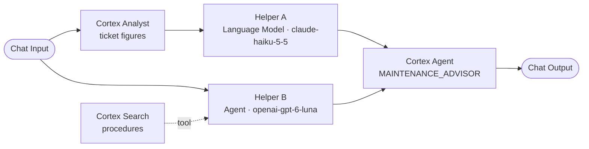
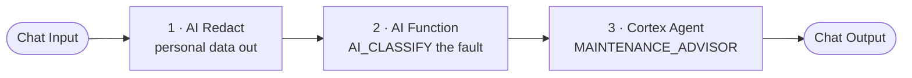
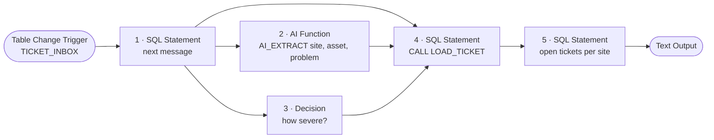

# Three starter examples

Three small flows on the same sample data: a maintenance team with tickets, procedures and a Cortex Agent.
One SQL script creates everything they need, so you can rebuild them in your own account.

| # | Example | Pattern | Needs the LLM proxy |
|---|---|---|---|
| 1 | [Two helpers, one Cortex Agent](#1-two-helpers-one-cortex-agent) | Parallel | Yes |
| 2 | [Redact, classify, answer](#2-redact-classify-answer) | Sequential | No |
| 3 | [Inbox to tickets](#3-inbox-to-tickets) | Data engineering | No |

All data is synthetic.

## Set up, once

1. **Create the objects.** Open [`00_setup.sql`](00_setup.sql), replace `<WAREHOUSE>`, and run the whole script.
   It creates the schema `SNOWFLAKE_LANGFLOW.EXAMPLES`. Running it again puts the data back to its initial state.
2. **Import the flows.** In Langflow, upload the three `.json` files of this folder (drag them onto the flow list).
3. **Pick a role and a Context.** Open a flow, select a role that can read the schema, then open
   `[ Context ]` and select the schema `EXAMPLES` with its objects.

If your Langflow database is not called `SNOWFLAKE_LANGFLOW`, replace that name in the script and in the three
`.json` files before you start.

What the script creates:

| Object | Kind | Used by |
|---|---|---|
| `SERVICE_TICKETS` | Table, 30 tickets | 1, 2, 3 |
| `SERVICE_DOCS` | Table, 8 maintenance procedures | 1, 2 |
| `TICKET_INBOX` | Table, 4 raw messages | 3 |
| `TICKETS_ANALYTICS` | Semantic view on the tickets | 1, 2 |
| `DOC_SEARCH` | Cortex Search service on the procedures | 1, 2 |
| `MAINTENANCE_ADVISOR` | Cortex Agent with the two objects above as tools | 1, 2 |
| `NORMALIZE_SITE` | SQL function | 3 |
| `LOAD_TICKET` | Stored procedure | 3 |

---

## 1. Two helpers, one Cortex Agent

File: [`1_two_helpers_one_cortex_agent.json`](1_two_helpers_one_cortex_agent.json)

Two helpers work on the same question at the same time, each in its own way and on its own model. A Cortex Agent
reads both results and writes the answer.



| | Helper A | Helper B |
|---|---|---|
| Node | `Language Model` | `Agent` |
| How it gets data | The flow runs Cortex Analyst first and hands over the result | It decides by itself when to call Cortex Search |
| Job | Say what the ticket history tells | Find the procedure and its steps |

**Ask:** `Chiller C7 at MILANO_PLANT is leaking coolant and the line is stopped. What should the technician do?`

**You should see:** a short advice with severity, likely cause, ordered steps, the number of tickets for that
chiller in Milan, and the title "Chiller coolant leak procedure".

The two model names come from the LLM proxy. If your proxy serves other models, pick two of yours in the nodes.

## 2. Redact, classify, answer

File: [`2_sequential_redact_classify_agent.json`](2_sequential_redact_classify_agent.json)

One step after the other. Each node does one thing and passes its result on.



**Ask:** `Hi, this is Marco Bianchi (marco.bianchi@example.com, +39 333 1234567) from the Milan plant. Chiller C7 is leaking coolant and line 2 is stopped. What do we do?`

**You should see:**

| Step | Result |
|---|---|
| AI Redact | `Hi, this is [NAME] ([EMAIL], [PHONE_NUMBER]) from the Milan plant. ...` |
| AI_CLASSIFY | `cooling` |
| Cortex Agent | The advice, written without ever seeing the name, the email or the phone number |

## 3. Inbox to tickets

File: [`3_data_engineering_inbox_to_tickets.json`](3_data_engineering_inbox_to_tickets.json)

No chat. Raw messages land in a table; each run turns the oldest one into a clean ticket.



| Step | Node | What it does |
|---|---|---|
| 1 | `SQL Statement` (SELECT) | Reads the oldest message that has not been processed |
| 2 | `AI Function` | `AI_EXTRACT` reads site, asset and problem from the free text |
| 3 | `Decision` | Chooses the severity: low, medium, high or critical |
| 4 | `SQL Statement` (CALL) | The procedure `LOAD_TICKET` writes the ticket and marks the message as processed. It uses the function `NORMALIZE_SITE` to turn "Milan plant" into `MILANO_PLANT` |
| 5 | `SQL Statement` (SELECT) | Counts open and urgent tickets per site |

**Run it:** open the flow and run the last node (`Text Output`). Run it four times: one message per run.

**You should see** four new rows in `SERVICE_TICKETS`:

| Message | Site | Asset | Severity |
|---|---|---|---|
| "Milan plant, night shift: chiller C7 is losing coolant again and line 2 is stopped..." | `MILANO_PLANT` | `CHILLER_C7` | critical |
| "...at the Bologna depot the E5 packer makes a light rattling noise. No hurry..." | `BOLOGNA_DEPOT` | `PACKER_E5` | low |
| "TORINO - the light curtain on press A12 did not react twice this morning..." | `TORINO_PLANT` | `PRESS_A12` | high |
| "Napoli depot: conveyor B3 belt drifts to the left after every restart..." | `NAPOLI_DEPOT` | `CONVEYOR_B3` | medium |

```sql
SELECT TICKET_ID, SITE, ASSET, SEVERITY, NOTE
FROM SNOWFLAKE_LANGFLOW.EXAMPLES.SERVICE_TICKETS
WHERE SOURCE = 'ticket_inbox_flow';
```

A fifth run finds nothing to do and says so. Severity is chosen by a model, so it can differ by one level.

**The trigger.** The `Table Change Trigger` is saved as *Paused*: the first run creates its stream and its
suspended task in the schema (the role needs `CREATE STREAM` and `CREATE TASK` there; the role that ran the setup
script has them), and nothing runs on its own. Set it to *Active* to start the flow when new rows arrive in
`TICKET_INBOX`; that needs the trigger setup of the deployment guide (`sql/03_triggers_service_function.sql`).
This example was tested by running it from the canvas, not through the active trigger.

**Bind values.** Step 4 has three nodes connected to `Bind Values`: they fill the three `?` of the `CALL` in the
order the connections were drawn (message, extraction, decision).

## Start again

Run `00_setup.sql` again: tables, sample data, search service, agent, function and procedure are rebuilt.

The script replaces `TICKET_INBOX`, which leaves the stream of the trigger of example 3 stale. That does not matter
while the trigger is paused. If you activated it, drop the stream `LF_STRM_..._TICKET_INBOX` in the schema: the next
run of the flow creates a new one.
